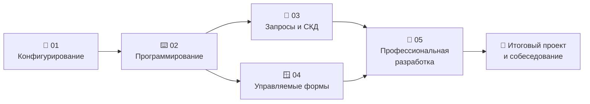

---
tags:
  - 1С/оглавление
---

# Конспект по 1С-программированию

> [!abstract] О конспекте
> Пошаговое пособие по разработке на платформе «1С:Предприятие 8» — от первого справочника до уровня **junior+**: конфигурирование, встроенный язык, запросы и СКД, управляемые формы и профессиональные темы (контроль остатков, расширения, интеграции, БСП, Git). Основная практика — на сквозной учебной базе «1С:Купец», платформа 8.5.1.1150, управляемое приложение. Для БСП, проверки нескольких сеансов и хранилища нужны отдельные стенды; требования указаны в разделе 05.

## Маршрут обучения

Разделы 03 и 04 можно проходить параллельно — оба опираются на 01–02. Ориентировочный темп при 1–2 часах в день — **3–4 месяца**.

| Раздел | О чём | Темп |
| --- | --- | --- |
| 🧱 [[01. Основы конфигурирования/00. Навигация по разделу|01. Основы конфигурирования]] | Объекты конфигурации без кода: справочники, документы, регистры, отчёты, роли. | 2–3 недели |
| ⌨️ [[02. Программирование/00. Навигация по разделу|02. Программирование]] | Встроенный язык: синтаксис, коллекции, работа с объектами базы, транзакции, отладка. | 3–4 недели |
| 🔎 [[03. Язык запросов и СКД/00. Навигация по разделу|03. Язык запросов и СКД]] | Запросы к данным и отчёты на системе компоновки данных. | 2–3 недели |
| 🪟 [[04. Программирование управляемых форм/00. Навигация по разделу|04. Программирование управляемых форм]] | Формы, команды, события, клиент-сервер, взаимодействие окон, списки. | 3 недели |
| 🚀 [[05. Профессиональная разработка/00. Навигация по разделу|05. Профессиональная разработка]] | Остатки и блокировки, печать, расширения, права, интеграции, БСП, командная работа. | 3–4 недели |

## Как устроена каждая заметка

| Элемент | Зачем |
| --- | --- |
| `Коротко` (синий блок вверху) | Суть темы в 2–3 предложениях — для повторения достаточно прочитать только его |
| Таблицы и схемы | Сравнения «что выбрать», порядок событий, структура объектов |
| Код с разбором | Рабочие примеры на объектах учебной базы; рядом указано, в каком модуле и контексте он выполняется |
| > [!warning] **Важно** | Типичные ошибки и ловушки |
| > [!tip] **Совет** | Приёмы, которые экономят время |
| > [!info] | Пояснения и связи с другими темами |
| `Проверь себя` (свёрнут внизу) | Вопросы с ответами — раскройте после чтения |
| Навигация `← · ↑ · →` | Предыдущая тема, раздел, следующая тема |

Значки в списках тем: ⭐ — ключевая тема, 🛠 — практика, 📌 — памятка для повторения.

## Как учиться по конспекту

1. **Идите по порядку** и повторяйте всё руками в своей учебной базе — чтение без практики почти не работает.
2. После темы откройте **«Проверь себя»** и ответьте, не подглядывая.
3. В конце раздела выполните **практику** 🛠 и сверьте контрольные числа.
4. Раз в неделю — повторение по блокам **«Коротко»** и памяткам 📌.
5. Финал — [[05. Профессиональная разработка/12. Итоговый проект и собеседование|итоговый проект «Мини-склад»]] в портфолио.

> [!tip] Возможности Obsidian
> - `Ctrl+O` — быстрый переход к заметке по названию, `Ctrl+Shift+F` — поиск по всему конспекту.
> - Панель **«Обратные ссылки»** показывает, где упоминается текущая тема.
> - **Граф** (`Ctrl+G`) и теги `#1С/…` помогают увидеть связи разделов.
> - Наведите курсор на ссылку с `Ctrl` — увидите предпросмотр заметки.

## Шпаргалки

- [[99. Шпаргалки/01. Глоссарий|📖 Глоссарий]] — термины курса со ссылками на темы
- [[99. Шпаргалки/02. Горячие клавиши|⌨️ Горячие клавиши]] — Конфигуратор, отладчик, Предприятие
- [[99. Шпаргалки/03. Встроенный язык — шпаргалка|📝 Встроенный язык]] — синтаксис на одной странице
- [[99. Шпаргалки/04. Где писать код|🧭 Где писать код]] — модули, события, клиент или сервер
- [[03. Язык запросов и СКД/31. Ошибки и памятка для повторения|📌 Памятка по запросам и СКД]]
- [[04. Программирование управляемых форм/28. Ошибки и памятка для повторения|📌 Памятка по управляемым формам]]

## Все темы

> [!example]- 🧱 01. Основы конфигурирования — 30 тем
> [[01. Основы конфигурирования/00. Навигация по разделу|Навигация по разделу]]
>
> - [[01. Основы конфигурирования/01. Платформа 1С|01. Платформа 1С]]
> - [[01. Основы конфигурирования/02. Версии платформы 1С|02. Версии платформы 1С]]
> - [[01. Основы конфигурирования/03. Информационная база 1С|03. Информационная база 1С]]
> - [[01. Основы конфигурирования/04. Интерфейс конфигуратора|04. Интерфейс конфигуратора]]
> - [[01. Основы конфигурирования/05. Версии конфигураций|05. Версии конфигураций]]
> - [[01. Основы конфигурирования/06. Интерфейс платформы|06. Интерфейс платформы]]
> - [[01. Основы конфигурирования/07. Константы|07. Константы]]
> - [[01. Основы конфигурирования/08. Справочники|08. Справочники]]
> - [[01. Основы конфигурирования/09. Форма справочника|09. Форма справочника]]
> - [[01. Основы конфигурирования/10. Интерфейс справочника|10. Интерфейс справочника]]
> - [[01. Основы конфигурирования/11. Ссылочный тип данных|11. Ссылочный тип данных]]
> - [[01. Основы конфигурирования/12. Перечисления|12. Перечисления]]
> - [[01. Основы конфигурирования/13. Пометка удаления|13. Пометка удаления]]
> - [[01. Основы конфигурирования/14. Документы|14. Документы]]
> - [[01. Основы конфигурирования/15. Подсистемы, интерфейс и общие объекты|15. Подсистемы, интерфейс и общие объекты]]
> - [[01. Основы конфигурирования/16. Приёмы работы в Конфигураторе|16. Приёмы работы в Конфигураторе]]
> - [[01. Основы конфигурирования/17. Регистры накоплений|17. Регистры накоплений]]
> - [[01. Основы конфигурирования/18. Отчёты|18. Отчёты]]
> - [[01. Основы конфигурирования/19. Пользователи и Роли|19. Пользователи и Роли]]
> - [[01. Основы конфигурирования/20. Регистры сведений|20. Регистры сведений]]
> - [[01. Основы конфигурирования/21. Журналы документов и нумерация|21. Журналы документов и нумерация]]
> - [[01. Основы конфигурирования/22. Предопределённые данные и заполнение|22. Предопределённые данные и заполнение]]
> - [[01. Основы конфигурирования/23. Обработки и внешние файлы|23. Обработки и внешние файлы]]
> - [[01. Основы конфигурирования/24. Макеты и печатные формы|24. Макеты и печатные формы]]
> - [[01. Основы конфигурирования/25. Общие реквизиты и составные типы|25. Общие реквизиты и составные типы]]
> - [[01. Основы конфигурирования/26. Функциональные опции и параметры сеанса|26. Функциональные опции и параметры сеанса]]
> - [[01. Основы конфигурирования/27. Сравнение, поддержка и расширения|27. Сравнение, поддержка и расширения]]
> - [[01. Основы конфигурирования/28. Резервные копии и обслуживание базы|28. Резервные копии и обслуживание базы]]
> - [[01. Основы конфигурирования/29. Остальные объекты конфигурации|29. Остальные объекты конфигурации]]
> - [[01. Основы конфигурирования/30. Практика по конфигурированию|30. Практика по конфигурированию]]

> [!example]- ⌨️ 02. Программирование — 33 тем
> [[02. Программирование/00. Навигация по разделу|Навигация по разделу]]
>
> - [[02. Программирование/01. Основы программирования|01. Основы программирования]]
> - [[02. Программирование/02. Переменные|02. Переменные]]
> - [[02. Программирование/03. Основы типов значений|03. Основы типов значений]]
> - [[02. Программирование/04. Работа со строками|04. Работа со строками]]
> - [[02. Программирование/05. Работа с числами|05. Работа с числами]]
> - [[02. Программирование/06. Работа с датой|06. Работа с датой]]
> - [[02. Программирование/07. Работа с булевым типом|07. Работа с булевым типом]]
> - [[02. Программирование/08. Операции сравнения|08. Операции сравнения]]
> - [[02. Программирование/09. Процедуры и функции|09. Процедуры и функции]]
> - [[02. Программирование/10. Блок условия|10. Блок условия]]
> - [[02. Программирование/11. Блок цикла|11. Блок цикла]]
> - [[02. Программирование/12. Обработчики событий|12. Обработчики событий]]
> - [[02. Программирование/13. Асинхронность|13. Асинхронность]]
> - [[02. Программирование/14. Области в модулях|14. Области в модулях]]
> - [[02. Программирование/15. Работа с формой документа|15. Работа с формой документа]]
> - [[02. Программирование/16. Работа с модулями справочника|16. Работа с модулями справочника]]
> - [[02. Программирование/17. Работа с модулями документа|17. Работа с модулями документа]]
> - [[02. Программирование/18. Массивы|18. Массивы]]
> - [[02. Программирование/19. Структуры и соответствия|19. Структуры и соответствия]]
> - [[02. Программирование/20. Списки и деревья значений|20. Списки и деревья значений]]
> - [[02. Программирование/21. Таблицы значений|21. Таблицы значений]]
> - [[02. Программирование/22. Описание типов, метаданные и общие методы|22. Описание типов, метаданные и общие методы]]
> - [[02. Программирование/23. Программная работа со справочниками|23. Программная работа со справочниками]]
> - [[02. Программирование/24. Программная работа с документами|24. Программная работа с документами]]
> - [[02. Программирование/25. Программная работа с регистрами|25. Программная работа с регистрами]]
> - [[02. Программирование/26. Общие модули и контекст выполнения|26. Общие модули и контекст выполнения]]
> - [[02. Программирование/27. Ошибки и сообщения пользователю|27. Ошибки и сообщения пользователю]]
> - [[02. Программирование/28. Транзакции и блокировки|28. Транзакции и блокировки]]
> - [[02. Программирование/29. Отладка и проверка кода|29. Отладка и проверка кода]]
> - [[02. Программирование/30. Подписки на события|30. Подписки на события]]
> - [[02. Программирование/31. Файлы, JSON и временное хранилище|31. Файлы, JSON и временное хранилище]]
> - [[02. Программирование/32. Фоновые и регламентные задания|32. Фоновые и регламентные задания]]
> - [[02. Программирование/33. Практика по программированию|33. Практика по программированию]]

> [!example]- 🔎 03. Язык запросов и СКД — 31 тем
> [[03. Язык запросов и СКД/00. Навигация по разделу|Навигация по разделу]]
>
> - [[03. Язык запросов и СКД/01. Запросы и таблицы базы|01. Запросы и таблицы базы]]
> - [[03. Язык запросов и СКД/02. Первый запрос в конструкторе и в коде|02. Первый запрос в конструкторе и в коде]]
> - [[03. Язык запросов и СКД/03. Выбор полей, псевдонимы и сортировка|03. Выбор полей, псевдонимы и сортировка]]
> - [[03. Язык запросов и СКД/04. Условия и отбор строк|04. Условия и отбор строк]]
> - [[03. Язык запросов и СКД/05. Параметры и границы периода|05. Параметры и границы периода]]
> - [[03. Язык запросов и СКД/06. Ссылки, иерархия и составные типы|06. Ссылки, иерархия и составные типы]]
> - [[03. Язык запросов и СКД/07. Запрос к табличной части документа|07. Запрос к табличной части документа]]
> - [[03. Язык запросов и СКД/08. Соединения таблиц|08. Соединения таблиц]]
> - [[03. Язык запросов и СКД/09. NULL и отсутствующие значения|09. NULL и отсутствующие значения]]
> - [[03. Язык запросов и СКД/10. Группировка и агрегатные функции|10. Группировка и агрегатные функции]]
> - [[03. Язык запросов и СКД/11. Итоги и обход результата запроса|11. Итоги и обход результата запроса]]
> - [[03. Язык запросов и СКД/12. Выражения и функции языка запросов|12. Выражения и функции языка запросов]]
> - [[03. Язык запросов и СКД/13. Объединение результатов|13. Объединение результатов]]
> - [[03. Язык запросов и СКД/14. Вложенные запросы|14. Вложенные запросы]]
> - [[03. Язык запросов и СКД/15. Временные таблицы и пакеты запросов|15. Временные таблицы и пакеты запросов]]
> - [[03. Язык запросов и СКД/16. Виртуальные таблицы регистров накопления|16. Виртуальные таблицы регистров накопления]]
> - [[03. Язык запросов и СКД/17. Регистры сведений и срез последних|17. Регистры сведений и срез последних]]
> - [[03. Язык запросов и СКД/18. Проверка и ускорение запросов|18. Проверка и ускорение запросов]]
> - [[03. Язык запросов и СКД/19. Как устроена СКД|19. Как устроена СКД]]
> - [[03. Язык запросов и СКД/20. Создание отчёта и набора данных|20. Создание отчёта и набора данных]]
> - [[03. Язык запросов и СКД/21. Поля и ресурсы СКД|21. Поля и ресурсы СКД]]
> - [[03. Язык запросов и СКД/22. Параметры периода в СКД|22. Параметры периода в СКД]]
> - [[03. Язык запросов и СКД/23. Структура отчёта и выбранные поля|23. Структура отчёта и выбранные поля]]
> - [[03. Язык запросов и СКД/24. Отбор, сортировка и пользовательские настройки|24. Отбор, сортировка и пользовательские настройки]]
> - [[03. Язык запросов и СКД/25. Вычисляемые поля и оформление|25. Вычисляемые поля и оформление]]
> - [[03. Язык запросов и СКД/26. Таблицы, диаграммы и варианты отчёта|26. Таблицы, диаграммы и варианты отчёта]]
> - [[03. Язык запросов и СКД/27. Несколько наборов и расширение языка СКД|27. Несколько наборов и расширение языка СКД]]
> - [[03. Язык запросов и СКД/28. Программное формирование отчёта СКД|28. Программное формирование отчёта СКД]]
> - [[03. Язык запросов и СКД/29. Практика по языку запросов|29. Практика по языку запросов]]
> - [[03. Язык запросов и СКД/30. Практика по СКД|30. Практика по СКД]]
> - [[03. Язык запросов и СКД/31. Ошибки и памятка для повторения|31. Ошибки и памятка для повторения]]

> [!example]- 🪟 04. Программирование управляемых форм — 29 тем
> [[04. Программирование управляемых форм/00. Навигация по разделу|Навигация по разделу]]
>
> - [[04. Программирование управляемых форм/01. Управляемая форма и её данные|01. Управляемая форма и её данные]]
> - [[04. Программирование управляемых форм/02. Создание формы документа|02. Создание формы документа]]
> - [[04. Программирование управляемых форм/03. Реквизиты формы и ПутьКДанным|03. Реквизиты формы и ПутьКДанным]]
> - [[04. Программирование управляемых форм/04. Группы и страницы|04. Группы и страницы]]
> - [[04. Программирование управляемых форм/05. Модуль формы и клиент-сервер|05. Модуль формы и клиент-сервер]]
> - [[04. Программирование управляемых форм/06. Команды формы и кнопки|06. Команды формы и кнопки]]
> - [[04. Программирование управляемых форм/07. Создание, открытие и закрытие формы|07. Создание, открытие и закрытие формы]]
> - [[04. Программирование управляемых форм/08. Изменение полей и обработчики событий|08. Изменение полей и обработчики событий]]
> - [[04. Программирование управляемых форм/09. Таблица формы и текущая строка|09. Таблица формы и текущая строка]]
> - [[04. Программирование управляемых форм/10. Пересчёт строк и итога товаров|10. Пересчёт строк и итога товаров]]
> - [[04. Программирование управляемых форм/11. Видимость, доступность и ТолькоПросмотр|11. Видимость, доступность и ТолькоПросмотр]]
> - [[04. Программирование управляемых форм/12. Проверка заполнения и сообщения|12. Проверка заполнения и сообщения]]
> - [[04. Программирование управляемых форм/13. Запись из формы и события записи|13. Запись из формы и события записи]]
> - [[04. Программирование управляемых форм/14. Данные формы и прикладной объект|14. Данные формы и прикладной объект]]
> - [[04. Программирование управляемых форм/15. Открытие форм и параметры|15. Открытие форм и параметры]]
> - [[04. Программирование управляемых форм/16. Общая форма для подбора товара|16. Общая форма для подбора товара]]
> - [[04. Программирование управляемых форм/17. Выбор и возврат результата|17. Выбор и возврат результата]]
> - [[04. Программирование управляемых форм/18. Ограничение выбора значений|18. Ограничение выбора значений]]
> - [[04. Программирование управляемых форм/19. Форма списка и динамический список|19. Форма списка и динамический список]]
> - [[04. Программирование управляемых форм/20. Программный отбор списка|20. Программный отбор списка]]
> - [[04. Программирование управляемых форм/21. Условное оформление|21. Условное оформление]]
> - [[04. Программирование управляемых форм/22. Асинхронные вопросы пользователю|22. Асинхронные вопросы пользователю]]
> - [[04. Программирование управляемых форм/23. Программное создание элементов формы|23. Программное создание элементов формы]]
> - [[04. Программирование управляемых форм/24. Загрузка таблицы формы на сервере|24. Загрузка таблицы формы на сервере]]
> - [[04. Программирование управляемых форм/25. Отладка управляемой формы|25. Отладка управляемой формы]]
> - [[04. Программирование управляемых форм/26. Практика по форме документа|26. Практика по форме документа]]
> - [[04. Программирование управляемых форм/27. Практика по взаимодействию форм|27. Практика по взаимодействию форм]]
> - [[04. Программирование управляемых форм/28. Ошибки и памятка для повторения|28. Ошибки и памятка для повторения]]
> - [[04. Программирование управляемых форм/29. Учебная обработка и проверка примеров|29. Учебная обработка и проверка примеров]]

> [!example]- 🚀 05. Профессиональная разработка — 12 тем
> [[05. Профессиональная разработка/00. Навигация по разделу|Навигация по разделу]]
>
> - [[05. Профессиональная разработка/01. Регистр остатков на практике|01. Регистр остатков на практике]]
> - [[05. Профессиональная разработка/02. Контроль остатков и блокировки|02. Контроль остатков и блокировки]]
> - [[05. Профессиональная разработка/03. Печатная форма документа|03. Печатная форма документа]]
> - [[05. Профессиональная разработка/04. Расширения и перехват методов|04. Расширения и перехват методов]]
> - [[05. Профессиональная разработка/05. Права доступа и RLS в коде|05. Права доступа и RLS в коде]]
> - [[05. Профессиональная разработка/06. HTTP-запросы к внешним сервисам|06. HTTP-запросы к внешним сервисам]]
> - [[05. Профессиональная разработка/07. HTTP-сервисы своей базы|07. HTTP-сервисы своей базы]]
> - [[05. Профессиональная разработка/08. XML и обмен данными|08. XML и обмен данными]]
> - [[05. Профессиональная разработка/09. БСП и типовые конфигурации|09. БСП и типовые конфигурации]]
> - [[05. Профессиональная разработка/10. Хранилище, EDT и Git|10. Хранилище, EDT и Git]]
> - [[05. Профессиональная разработка/11. Стандарты кода и самопроверка|11. Стандарты кода и самопроверка]]
> - [[05. Профессиональная разработка/12. Итоговый проект и собеседование|12. Итоговый проект и собеседование]]

## Учебная база и примеры

- Сквозная конфигурация «1С:Купец»: справочники `Номенклатура`, `Контрагенты`, `Договоры`, `Сотрудники`, `Склады`; документы `ЗаказКлиента`, `ПриходнаяНакладная`, `РасходнаяНакладная`; регистры `Продажи`, `ТоварыНаСкладах`, `ЦеныНоменклатуры`. Каждый новый объект описан в теме, где он появляется.
- Готовая внешняя обработка для экспериментов с формами — [[04. Программирование управляемых форм/29. Учебная обработка и проверка примеров|04/29]].
- Скриншоты — в папке `Картинки/` по разделам.
- Доступность методов проверяйте в **Синтакс-помощнике** своей версии платформы с учётом режима совместимости.
