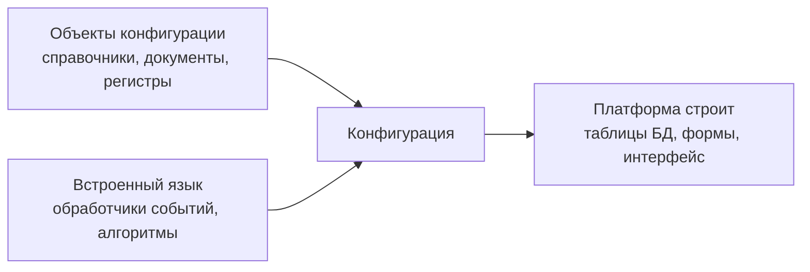

---
tags:
  - 1С/конфигурирование
---

> [!abstract] Коротко
> **Платформа** — «движок» 1С, **конфигурация** — программа, написанная на нём, **информационная база** — конфигурация вместе с данными. Разработчик описывает объекты визуально, а поведение — на встроенном языке.

## Три главных понятия

| Понятие | Что это | Аналогия |
| --- | --- | --- |
| **Платформа** «1С:Предприятие» | Среда исполнения приложений и набор инструментов разработки и администрирования | Движок + IDE |
| **Конфигурация** (прикладное решение) | Описание конкретной программы: объекты, формы, код, права | Исходный код приложения |
| **Информационная база** | Конфигурация + накопленные данные пользователя | Приложение вместе с его базой данных |

Типовые решения — «1С:Бухгалтерия», «1С:УТ», «1С:ЗУП» — это **разные конфигурации на одной платформе**. Программист 1С почти всегда дорабатывает существующую конфигурацию, а не пишет её с нуля.

## Как устроена разработка

1. **Визуальное конструирование.** В дереве конфигурации добавляем объекты (справочник «Номенклатура», документ «Расходная накладная») и настраиваем их свойства. Платформа сама создаёт по ним таблицы базы данных, стандартные формы и команды.
2. **Программирование.** На встроенном языке описываем то, чего нет «из коробки»: расчёт сумм, проверки при записи, формирование движений регистров.

> [!tip] Главная идея 1С
> Большую часть типовой работы (хранение, формы, списки, права, отчёты) платформа делает сама. Код пишем только там, где нужна прикладная логика. Поэтому хороший разработчик сначала ищет **подходящий объект или настройку**, и лишь потом пишет код.

## Где работает платформа

| Устройства | Операционные системы |
| --- | --- |
| Компьютеры и серверы | Windows, Linux, macOS |
| Мобильные устройства | Android, iOS (мобильная платформа) |

Конкретные поддерживаемые версии ОС зависят от версии и компонента платформы (клиент, сервер, мобильная платформа). Windows Phone встречается в старых материалах, но к актуальным мобильным ОС не относится.

> [!question]- Проверь себя
> 1. Чем конфигурация отличается от информационной базы?
> 2. Почему «1С:Бухгалтерия» и «1С:ЗУП» можно запустить на одной платформе?
> 3. Что делает платформа автоматически после того, как мы добавили справочник?
>
> > [!success]- Ответы
> > 1. Конфигурация — описание программы; информационная база — конфигурация плюс введённые данные.
> > 2. Это разные конфигурации, а исполняет их одна и та же платформа.
> > 3. Создаёт таблицу в базе данных, стандартные формы списка и элемента, команды открытия.

%% навигация %%

---
← [[01. Основы конфигурирования/00. Навигация по разделу|00. Навигация по разделу]] · [[00. Оглавление|⌂ Оглавление]] · [[01. Основы конфигурирования/02. Версии платформы 1С|02. Версии платформы 1С]] →
