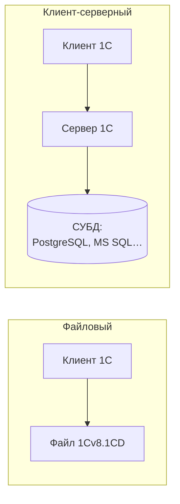

---
tags:
  - 1С/конфигурирование
---

> [!abstract] Коротко
> **Информационная база (ИБ)** = конфигурация + данные. Бывает **файловой** (всё в файле `1Cv8.1CD`) и **клиент-серверной** (данные в СУБД, работу организует сервер 1С). Запускается в двух режимах: **1С:Предприятие** — для пользователя, **Конфигуратор** — для разработчика.

## Что внутри

![[Pasted image 20260908120513.png]]

*Информационная база состоит из конфигурации и данных.*

С помощью конфигурации разработчик:
- задаёт состав прикладных объектов — какие справочники, документы и регистры есть в программе;
- меняет стандартное поведение через обработчики событий платформы;
- настраивает внешний вид: формы, разделы, команды.

Данные — всё, что ввели пользователи: товары, контрагенты, документы, движения регистров.

## Создание информационной базы

В окне запуска: **Добавить… → Создание новой информационной базы → Создание информационной базы без конфигурации** (или из шаблона) → указываем имя и каталог.

После создания в выбранном каталоге появятся файлы:

![[Pasted image 20260908121622.png]]

*Каталог файловой базы: основной файл `1Cv8.1CD`, папка журнала регистрации `1Cv8Log` и служебные файлы `.cfl`.*

| Файл | Назначение |
| --- | --- |
| `1Cv8.1CD` | Основной файл файловой ИБ: и конфигурация, и данные |
| `1Cv8Log` | Журнал регистрации |
| `*.cfl` | Служебные данные и блокировки |

`1Cv8.1CD` не равен файлу конфигурации `.cf`: в `.cf` наших товаров и документов нет. Сводная таблица форматов — в [[23. Обработки и внешние файлы]].

> [!warning] Важно
> Копировать `1Cv8.1CD` как резервную копию можно только при **завершённых сеансах**: копия во время записи может оказаться повреждённой. Надёжный способ — выгрузка в `.dt`, см. [[28. Резервные копии и обслуживание базы]]. Служебные файлы не удаляем только потому, что они маленькие.

## Режимы запуска

![[Pasted image 20260908121924.png]]

*Окно запуска: список баз слева, справа кнопки «1С:Предприятие» и «Конфигуратор». Внизу — путь к выбранной базе.*

| Кнопка | Для кого | Что делаем |
| --- | --- | --- |
| **1С:Предприятие** | Пользователь | Работаем с данными: вводим документы, смотрим отчёты |
| **Конфигуратор** | Разработчик, администратор | Меняем конфигурацию, пишем код, отлаживаем, делаем выгрузки |

Из Конфигуратора Предприятие запускается клавишей **F5** (с отладкой) или **Ctrl+F5** (без отладки).

## Файловый и клиент-серверный варианты

| | Файловый | Клиент-серверный |
| --- | --- | --- |
| Где данные | Файл `1Cv8.1CD` | СУБД (PostgreSQL, MS SQL Server и др.) |
| Для чего | Учёба, небольшие базы, несколько пользователей | Рабочие базы, много пользователей, большие объёмы |
| Резервное копирование | Выгрузка `.dt` или копия файла | Средства СУБД + выгрузка `.dt` |

> [!warning] Клиент и сервер есть всегда
> Разделение кода на клиентский и серверный (`&НаКлиенте`, `&НаСервере`) существует **и в файловой базе**. Директива `&НаСервере` не означает, что где-то стоит отдельный серверный компьютер: в файловом варианте серверную часть выполняет сама платформа на этом же компьютере. Подробно — [[02. Программирование/26. Общие модули и контекст выполнения|26. Общие модули и контекст выполнения]].

> [!question]- Проверь себя
> 1. Попадут ли введённые документы в файл `.cf`?
> 2. Можно ли писать `&НаСервере` в файловой базе?
> 3. Почему нельзя копировать `1Cv8.1CD`, пока пользователи работают?
>
> > [!success]- Ответы
> > 1. Нет, `.cf` содержит только конфигурацию. Данные сохраняет выгрузка `.dt`.
> > 2. Да. Клиент-серверная модель кода не зависит от варианта базы.
> > 3. Файл может меняться во время копирования, и копия окажется несогласованной.

%% навигация %%

---
← [[01. Основы конфигурирования/02. Версии платформы 1С|02. Версии платформы 1С]] · [[01. Основы конфигурирования/00. Навигация по разделу|↑ Раздел]] · [[00. Оглавление|⌂ Оглавление]] · [[01. Основы конфигурирования/04. Интерфейс конфигуратора|04. Интерфейс конфигуратора]] →
