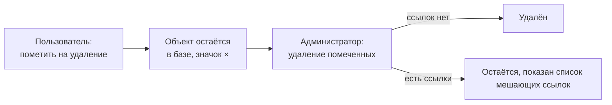

---
tags:
  - 1С/конфигурирование
---

> [!abstract] Коротко
> В 1С объекты обычно не удаляют сразу, а **помечают на удаление** (`Del`). Затем администратор запускает **«Удаление помеченных объектов»**: платформа удаляет только те объекты, на которые никто не ссылается. **Непосредственное удаление** (`Shift+Del`) проверку не выполняет и оставляет «битые» ссылки.

## Зачем двухэтапное удаление

**Пометка удаления** — стандартный реквизит `ПометкаУдаления` (Булево). На нём построен механизм удаления с **контролем ссылочной целостности**: объект не удалится, если на него ссылаются другие данные.

С точки зрения платформы удаление без контроля допустимо, и ссылки на отсутствующие объекты ошибкой базы не считаются. Поэтому за целостность отвечает именно этот механизм — и пользователю обычно дают право только на пометку.



## Пометка

В списке: ПКМ → **Пометить на удаление / Снять пометку** (`Del`):

![[Pasted image 20260909192907.png]]

*Контекстное меню списка. Помеченный элемент «Магомедов М.М.» отмечен красным крестиком.*

Помеченный объект никуда не исчез: его можно открыть, снять пометку, на него по-прежнему ссылаются документы.

## Удаление помеченных объектов

Меню (≡) → **Функции для технического специалиста**:

![[Pasted image 20260909193254.png]]

*Главное меню 1С:Предприятия: пункт «Функции для технического специалиста».*

→ **Стандартные → Удаление помеченных объектов**. Доступно два режима:

![[Pasted image 20260909193459.png]]

*Выбор режима: полное удаление всех помеченных или выборочное.*

При выборочном удалении отмечаем нужные объекты:

![[Pasted image 20260909193653.png]]

*Список помеченных объектов: два сотрудника.*

Если на объект есть ссылки, он не удалится, а платформа сообщит об этом. Остальные помеченные объекты удаляются:

![[Pasted image 20260909193806.png]]

*Результат: один объект удалён, второй нет — на него ссылаются. «Далее» покажет, кто именно.*

> [!tip] В типовых конфигурациях
> В решениях на БСП удаление помеченных — отдельная обработка в разделе «Администрирование» с более удобным интерфейсом. Принцип тот же.

## Непосредственное удаление

**Ещё → Удалить** (`Shift+Del`) удаляет объект сразу, без проверки ссылок. Команда доступна только при наличии права «Интерактивное удаление»:

![[Pasted image 20260909195058.png]]

*Меню «Ещё» формы списка: «Удалить» (Shift+Del) рядом с «Пометить на удаление» (Del).*

> [!warning] Битые ссылки
> Если удалить объект, на который ссылались, в этих местах появится `<Объект не найден>` с идентификатором:
>
> ![[Pasted image 20260909195150.png]]
>
> *Константа «Генеральный директор» ссылается на удалённого сотрудника.*
>
> Поэтому право непосредственного удаления обычным пользователям не выдают.

## В коде

```1C
// Сервер: пометить (с проверкой ссылок при последующем удалении помеченных)
Объект = Ссылка.ПолучитьОбъект();
Объект.УстановитьПометкуУдаления(Истина);

// Непосредственное удаление — без контроля ссылок, используем осознанно
Объект.Удалить();
```

У документов пометка удаления снимает проведение: [[14. Документы]].

> [!question]- Проверь себя
> 1. Пользователь пометил контрагента на удаление. Удалён ли он из базы?
> 2. Почему «Удаление помеченных» не удалило один из объектов?
> 3. Почему пользователям не дают право на `Shift+Del`?
>
> > [!success]- Ответы
> > 1. Нет, установлен только признак `ПометкаУдаления = Истина`.
> > 2. На него ссылаются другие данные — контроль ссылочной целостности.
> > 3. Непосредственное удаление не проверяет ссылки и оставляет «битые» ссылки в других объектах.

%% навигация %%

---
← [[01. Основы конфигурирования/12. Перечисления|12. Перечисления]] · [[01. Основы конфигурирования/00. Навигация по разделу|↑ Раздел]] · [[00. Оглавление|⌂ Оглавление]] · [[01. Основы конфигурирования/14. Документы|14. Документы]] →
