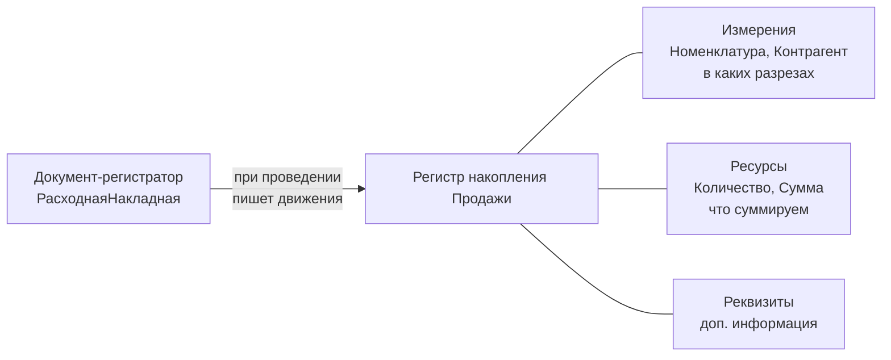

---
tags:
  - 1С/конфигурирование
---

> [!abstract] Коротко
> **Регистр накопления** хранит **движения** — изменения числовых показателей (количества, суммы) в разрезах **измерений**. Вид регистра: **Обороты** — сколько продали за период; **Остатки** — сколько есть на момент (+ обороты). Записи в регистр делает **документ-регистратор** при проведении. Итоги платформа считает сама через **виртуальные таблицы**.

## Зачем нужны регистры

Документ хранит факт «продали 3 чайника Иванову». Чтобы быстро ответить «сколько чайников продали за февраль» или «сколько столов на складе», нужна структура, оптимизированная под итоги. Это **регистры**.

**Регистр накопления** — многомерная структура, в которую документы «накапливают» изменения:

![[Pasted image 20260916102328.png]]

*Записи регистра «Продажи»: период, разрезы (номенклатура, контрагент) и количество.*

Для регистра платформа автоматически поддерживает **итоги** и предоставляет **виртуальные таблицы** — например, обороты за период, свёрнутые по нужным разрезам:

![[Pasted image 20260916111331.png]]

*Сверху движения регистра, снизу виртуальная таблица оборотов за февраль: продажи стола сложились в 11 шт. на 109 590.*

## Структура регистра



| Часть | Вопрос | Пример | Тип |
| --- | --- | --- | --- |
| **Измерения** | В каких разрезах ведём учёт? | Номенклатура, Склад, Контрагент | Обычно ссылки |
| **Ресурсы** | Что накапливаем? | Количество, Сумма | **Только числа** — их складывают |
| **Реквизиты** | Что ещё полезно знать о записи? | Комментарий, Менеджер | Любой, итоги не считаются |

## Создание регистра

**Регистры накопления → ПКМ → Добавить**:

![[Pasted image 20260916111548.png]]

*Регистр накопления «Продажи»: вид регистра — «Обороты».*

| Вид регистра | Что умеет | Пример |
| --- | --- | --- |
| **Обороты** | Только изменения за период. Остатка «на дату» нет | Продажи, выручка, расходы |
| **Остатки** | Остаток на любой момент **и** обороты за период. Движения имеют вид **Приход/Расход** | Товары на складах, взаиморасчёты |

> [!tip] Как выбрать вид
> Задайте вопрос «сколько **есть** на дату?». Если вопрос имеет смысл (товар на складе, долг клиента) — регистр остатков. Если нет («сколько продаж есть на 1 марта» — бессмыслица) — оборотный.

На вкладке **«Данные»** добавляем измерения, ресурсы и реквизиты:

![[Pasted image 20260916112144.png]]

*Пустая вкладка «Данные»: группы «Измерения», «Ресурсы», «Реквизиты».*

![[Pasted image 20260916144338.png]]

*Регистр «Продажи»: измерения `Номенклатура` и `Контрагент`, ресурсы `Количество` и `Сумма`.*

- **Измерения** `Номенклатура`, `Контрагент` — чтобы анализировать, **что** и **кому** продали, и сворачивать данные по этим разрезам.
- **Ресурсы** `Количество`, `Сумма` — числа, которые складываются в итогах.

> [!warning] Права на регистр
> Обычно пользователь **не редактирует движения вручную** — он проводит документы и смотрит отчёты. Право на изменение регистра пользователям обычно не дают; просмотр — по необходимости.

## Регистратор и движения

**1. Регистраторы.** На вкладке «Регистраторы» отмечаем документы, которые могут писать в регистр:

![[Pasted image 20260916160801.png]]

*Регистратор регистра «Продажи» — документ `РасходнаяНакладная`.*

**2. Движения документа.** Пока документ ничего не записывает. Открываем `РасходнаяНакладная` → вкладка **«Движения»**:

![[Pasted image 20260916162234.png]]

*Вкладка «Движения»: проведение разрешено, удаление движений — автоматически при отмене проведения.*

Отмечаем регистр и запускаем **«Конструктор движений»**:

![[Pasted image 20260916162408.png]]

*Конструктор движений: слева регистры, справа реквизиты документа, внизу — поля регистра и выражения.*

Выбираем **табличную часть** — движение будет создаваться для каждой её строки — и нажимаем **«Заполнить выражения»**. Проверяем соответствия:

![[Pasted image 20260916162635.png]]

*Табличная часть «Товары»: `Номенклатура ← ТекСтрокаТовары.Товар`, `Контрагент ← Покупатель`, количество и сумма — из строки.*

У нашей накладной две табличные части (товары и услуги). Кнопкой «+» над списком регистров добавляем регистр ещё раз и заполняем его для `Услуги`.

**3. Код проведения.** После **ОК** в модуле объекта появится обработчик:

```1C
Процедура ОбработкаПроведения(Отказ, Режим)
	//{{__КОНСТРУКТОР_ДВИЖЕНИЙ_РЕГИСТРОВ
	// Данный фрагмент построен конструктором.
	// При повторном использовании конструктора, внесенные вручную изменения будут утеряны!!!

	// регистр Продажи
	Движения.Продажи.Записывать = Истина;
	Для Каждого ТекСтрокаТовары Из Товары Цикл
		Движение = Движения.Продажи.Добавить();
		Движение.Период = Дата;
		Движение.Номенклатура = ТекСтрокаТовары.Товар;
		Движение.Контрагент = Покупатель;
		Движение.Количество = ТекСтрокаТовары.Количество;
		Движение.Сумма = ТекСтрокаТовары.Сумма;
	КонецЦикла;

	// регистр Продажи
	Движения.Продажи.Записывать = Истина;
	Для Каждого ТекСтрокаУслуги Из Услуги Цикл
		Движение = Движения.Продажи.Добавить();
		Движение.Период = Дата;
		Движение.Номенклатура = ТекСтрокаУслуги.Услуга;
		Движение.Контрагент = Покупатель;
		Движение.Количество = 1;
		Движение.Сумма = ТекСтрокаУслуги.Сумма;
	КонецЦикла;

	//}}__КОНСТРУКТОР_ДВИЖЕНИЙ_РЕГИСТРОВ
КонецПроцедуры
```

| Строка | Смысл |
| --- | --- |
| `Движения.Продажи` | **Набор записей** регистра, принадлежащий этому документу |
| `.Записывать = Истина` | Записать набор после завершения проведения |
| `.Добавить()` | Новая запись (движение) в наборе |
| `Движение.Период = Дата` | Движение относится к дате документа |

## Просмотр движений

В Предприятии: **Сервис и настройки** (≡) → **Функции для технического специалиста**:

![[Pasted image 20260916163034.png]]

*Кнопка «Сервис и настройки» в правом верхнем углу.*

![[Pasted image 20260916163129.png]]

*Функции для технического специалиста: ветка «Регистры накопления» → «Продажи».*

![[Pasted image 20260916163150.png]]

*Движения регистра: у каждой записи — период, регистратор, номер строки, измерения и ресурсы.*

## Стандартные поля движения

| Поле | Смысл |
| --- | --- |
| `Регистратор` | Документ, которому принадлежит движение |
| `Период` | Момент, к которому относится движение (обычно дата документа) |
| `НомерСтроки` | Номер записи внутри набора движений (не обязательно номер строки табличной части) |
| `Активность` | Учитывается ли запись в итогах |
| `ВидДвижения` | Только у регистра остатков: `Приход` или `Расход` |

## Приход и расход

У регистра **остатков** направление задаёт `ВидДвижения`: `Приход` увеличивает ресурс, `Расход` уменьшает. Количество при этом пишем **положительным**.

> Пришло 10 телефонов (приход 10), отгрузили 3 (расход 3) → остаток 7. Если отгрузка с другого склада, она уменьшит остаток по **другому сочетанию измерений**.

```1C
Движение = Движения.ТоварыНаСкладах.ДобавитьРасход();
Движение.Период = Дата;
Движение.Номенклатура = СтрокаТовара.Товар;
Движение.Склад = Склад;
Движение.Количество = СтрокаТовара.Количество;
```

У **оборотного** регистра Приход/Расход нет. Возврат можно отразить отрицательными значениями ресурсов, если так устроены правила учёта.

## Повторное проведение и отмена

При повторном проведении набор движений регистратора **перезаписывается**, а не дополняется: продажи не задваиваются. Проверяем это: проводим документ → меняем количество → проводим снова → в регистре актуальные данные.

При отмене проведения движения удаляются согласно свойству **«Удаление движений»** на вкладке «Движения». Если автоматическое удаление отключено, это должен обеспечить разработчик.

> [!warning] Регистр остатков не запрещает минус
> Платформа **не запрещает** отрицательный остаток только из-за вида «Остатки». Контроль «нельзя продать больше, чем есть» пишет разработчик — с блокировкой данных, чтобы два пользователя не продали последнюю штуку одновременно. Полный пример — [[05. Профессиональная разработка/02. Контроль остатков и блокировки|Контроль остатков и блокировки]].

Виртуальные таблицы `Обороты`, `Остатки`, `ОстаткиИОбороты` не нужно заполнять — их рассчитывает платформа. Запросы к ним — [[03. Язык запросов и СКД/16. Виртуальные таблицы регистров накопления|16. Виртуальные таблицы регистров накопления]]. Подробнее о видах регистра — [документация 1С](https://v8.1c.ru/platforma/registr-nakopleniya/).

> [!question]- Проверь себя
> 1. Учёт денег в кассе — оборотный регистр или остатков? А выручка по менеджерам?
> 2. Почему ресурсы — только числа?
> 3. Что будет, если провести накладную дважды?
> 4. Кто запрещает продать больше, чем есть на складе?
>
> > [!success]- Ответы
> > 1. Касса — остатков (есть остаток на дату). Выручка — оборотный.
> > 2. Ресурсы суммируются в итогах.
> > 3. Набор движений перезапишется — дублей не будет.
> > 4. Только код разработчика в проведении (с управляемой блокировкой). Платформа сама этого не делает.

%% навигация %%

---
← [[01. Основы конфигурирования/16. Приёмы работы в Конфигураторе|16. Приёмы работы в Конфигураторе]] · [[01. Основы конфигурирования/00. Навигация по разделу|↑ Раздел]] · [[00. Оглавление|⌂ Оглавление]] · [[01. Основы конфигурирования/18. Отчёты|18. Отчёты]] →
