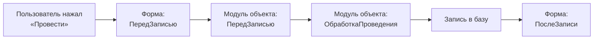

---
tags:
  - 1С/программирование
---

> [!abstract] Коротко
> **Обработчик события** — процедура, которую **вызывает платформа**, когда что-то происходит: запуск программы, запись объекта, проведение документа, изменение поля. Мы не вызываем её сами — мы решаем, *что делать* в этот момент. Сигнатуру (имя и параметры) системных обработчиков задаёт платформа, поэтому создаём их через Конфигуратор.

## Событийная модель 1С

Почти весь прикладной код в 1С — это реакции на события:



| Где | Примеры событий | Что обычно делаем |
| --- | --- | --- |
| Модуль управляемого приложения | `ПриНачалеРаботыСистемы`, `ПередЗавершениемРаботыСистемы` | Действия при запуске/выходе |
| Модуль сеанса | `УстановкаПараметровСеанса` | Заполнение параметров сеанса |
| Модуль объекта | `ОбработкаЗаполнения`, `ПередЗаписью`, `ПриЗаписи`, `ОбработкаПроведения`, `ОбработкаПроверкиЗаполнения` | Правила данных, которые должны работать **всегда** |
| Модуль менеджера | `ОбработкаПолученияПредставления`, `ОбработкаПолученияДанныхВыбора` | Поведение объекта как вида |
| Модуль формы | `ПриСозданииНаСервере`, `ПриОткрытии`, `ПередЗакрытием`, `<Поле>ПриИзменении` | Интерфейс и удобство ввода |
| Подписка на событие | Любое событие объекта | Общее правило для нескольких объектов ([[30. Подписки на события]]) |

## Как создать обработчик

**Модуль приложения / объекта / менеджера.** Открываем модуль → `Ctrl+Alt+P` или выпадающий список процедур над редактором → выбираем событие из списка. Конфигуратор вставит заготовку с правильными параметрами.

**Форма и её элементы.** Свойства элемента → вкладка **«События»** → кнопка с лупой у нужного события. Подробно — [[15. Работа с формой документа]].

## Пример: событие запуска

В модуле управляемого приложения:

```1C
Асинх Процедура ПриНачалеРаботыСистемы()

	Ждать ПредупреждениеАсинх("Привет, Марат!", 10, "Приветствие");

КонецПроцедуры
```

Процедура вызывается сразу после запуска клиентского приложения. `Асинх`/`Ждать` — современный способ показать окно и дождаться его закрытия ([[13. Асинхронность]]).

## Параметры обработчиков

Платформа передаёт в обработчик данные о событии. Самые частые параметры:

| Параметр | Смысл |
| --- | --- |
| `Отказ` | Установите `Истина`, чтобы **отменить** операцию (запись, проведение, открытие формы) |
| `СтандартнаяОбработка` | Установите `Ложь`, чтобы отключить стандартное поведение платформы |
| `РежимЗаписи`, `РежимПроведения` | Как выполняется запись документа |
| `ДанныеЗаполнения` | Основание, по которому заполняется новый объект |
| `Элемент` | Элемент формы, который вызвал событие |

```1C
Процедура ПередЗаписью(Отказ, РежимЗаписи, РежимПроведения)
	Если НЕ ЗначениеЗаполнено(Покупатель) Тогда
		Отказ = Истина;  // запись не выполнится
	КонецЕсли;
КонецПроцедуры
```

> [!warning] Сигнатура и связь
> - У системных обработчиков объекта **имя и параметры фиксированы**: `ПередЗаписью` справочника и документа имеют разные параметры. Не переписываем их по памяти — создаём через Конфигуратор.
> - В модуле **формы** имя обработчика может быть любым, но он должен быть **указан в свойствах** формы или элемента. Процедура «с похожим именем» сама к событию не подключится.
> - Не сбрасываем `Отказ = Ложь`: его могла установить другая проверка.

> [!question]- Проверь себя
> 1. Кто вызывает обработчик `ПередЗаписью`?
> 2. Где писать проверку, которая должна срабатывать и при записи из формы, и при загрузке из файла?
> 3. Написали в модуле формы процедуру `ТоварыКоличествоПриИзменении`, но она не вызывается. Почему?
>
> > [!success]- Ответы
> > 1. Платформа, при попытке записать объект.
> > 2. В модуле объекта (или подписке) — обработчики формы при программной записи не вызываются.
> > 3. Она не указана в свойстве события `ПриИзменении` колонки формы.

%% навигация %%

---
← [[02. Программирование/11. Блок цикла|11. Блок цикла]] · [[02. Программирование/00. Навигация по разделу|↑ Раздел]] · [[00. Оглавление|⌂ Оглавление]] · [[02. Программирование/13. Асинхронность|13. Асинхронность]] →
