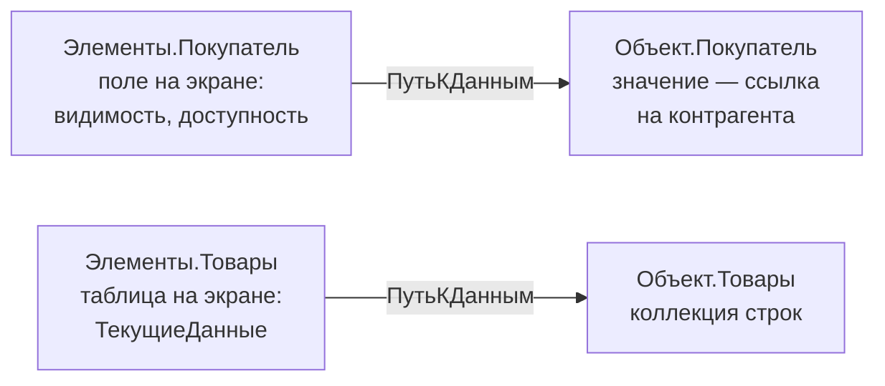

---
tags:
  - 1С/формы
---

> [!abstract] Коротко
> Управляемая форма состоит из четырёх частей: **реквизиты** (данные), **элементы** (что видит пользователь), **команды** (действия) и **модуль** (код). Элемент связан с данными через **ПутьКДанным**. `Объект` — основной реквизит формы документа; это **данные формы**, а не `ДокументОбъект`. Изменения живут в форме до записи.

## Учебный пример раздела

Работаем в базе «1С:Купец» с документом `РасходнаяНакладная`:

| Объект | Что используем |
| --- | --- |
| Шапка | `Покупатель` — `СправочникСсылка.Контрагенты` |
| Табличная часть `Товары` | `Товар`, `Количество`, `Цена`, `Сумма` |
| Табличная часть `Услуги` и общий `ИтоговаяСумма` | Существуют, мы их **не трогаем** |
| Реквизит формы `ИтогТоваров` | Создадим в теме 03 — учебный итог только по товарам |

> [!warning] Имена из дерева, а не с экрана
> В документе поле называется `Товар`, хотя в регистре продаж — `Номенклатура`. В коде используем имена из дерева конфигурации, а не надписи, которые видит пользователь.

## Четыре части формы

**Документы → РасходнаяНакладная → Формы → ФормаДокумента**:

![[УФ-02-Редактор-формы.png]]

*Редактор формы в «1С:Купец», 8.5.1.1150: слева элементы, справа реквизиты/команды, внизу предпросмотр и вкладка «Модуль».*

| Часть | За что отвечает | Пример |
| --- | --- | --- |
| **Реквизиты** | Данные формы | `Объект`, `ИтогТоваров` |
| **Элементы** | Интерфейс | Поле покупателя, таблица товаров, кнопка |
| **Команды** | Действия | «Показать итог товаров» |
| **Модуль** | Код поведения | Пересчёт, проверки, открытие подбора |

Предпросмотр внизу показывает расположение, но обработчики работают только в 1С:Предприятии.

## Данные и элемент — разные вещи



```1C
// Внутри клиентской процедуры модуля формы
СсылкаНаПокупателя = Объект.Покупатель;          // данные
Элементы.Покупатель.ТолькоПросмотр = Истина;     // свойство элемента интерфейса
```

Вторая строка не меняет покупателя — она запрещает редактировать его через это поле.

> [!warning] Удаление поля ≠ удаление данных
> Удалили поле из дерева элементов — реквизит документа остался в базе, пропал лишь способ его показать. Удаление реквизита **в дереве конфигурации** — уже изменение структуры данных.

## Что такое `Объект`

`Объект` — основной реквизит формы документа. Через него доступны покупатель и строки товаров, но тип у него — **данные формы** (`ДанныеФормыСтруктура`), а не `ДокументОбъект.РасходнаяНакладная`. Поэтому методы объекта документа (`Записать()`, `Провести()` и т. п.) у `Объект` на клиенте недоступны. Как преобразовать данные формы в объект — [[14. Данные формы и прикладной объект]].

Пока документ не записан, изменения есть только в открытой форме: пользователь может закрыть окно без сохранения.

## Почему «управляемая»

Мы описываем **дерево элементов и свойства**, а размещение по экрану делает платформа — с учётом групп, размера окна и клиента (тонкий, веб, мобильный). Координаты полей не рисуем.

Форма работает в клиент-серверной модели: на клиенте — ввод и кнопки, на сервере — обращения к базе и запросы. Это действует и в файловой базе. Директивы `&НаКлиенте`, `&НаСервере` разберём в [[05. Модуль формы и клиент-сервер]]. Общий принцип — в [документации 1С об управляемых формах](https://kb.1ci.com/1C_Enterprise_Platform/1C_Enterprise_Platform_Overview/Rapid_development_environment/Forms/?language=en).

## Упражнение

1. Выберите в дереве элементов поле покупателя, найдите свойства **Имя** и **ПутьКДанным** — это разные свойства.
2. В реквизитах раскройте `Объект` и найдите `Покупатель`.
3. Выберите таблицу товаров — проверьте путь `Объект.Товары`.
4. Найдите вкладки **Команды** и **Модуль**.

Если `Объекта` с реквизитами накладной нет — вы открыли не ту форму (например, форму списка).

> [!question]- Проверь себя
> 1. Где хранится выбранный покупатель — в `Элементы.Покупатель` или `Объект.Покупатель`?
> 2. Можно ли на клиенте вызвать `Объект.Записать()`?
> 3. Удалили поле «Договор» с формы. Пропали ли договоры в документах?
>
> > [!success]- Ответы
> > 1. В `Объект.Покупатель`; элемент лишь показывает его.
> > 2. Нет: `Объект` — данные формы, а не объект документа. Запись делает стандартная команда или серверный код.
> > 3. Нет, удалён только элемент интерфейса.

%% навигация %%

---
← [[04. Программирование управляемых форм/00. Навигация по разделу|00. Навигация по разделу]] · [[00. Оглавление|⌂ Оглавление]] · [[04. Программирование управляемых форм/02. Создание формы документа|02. Создание формы документа]] →
