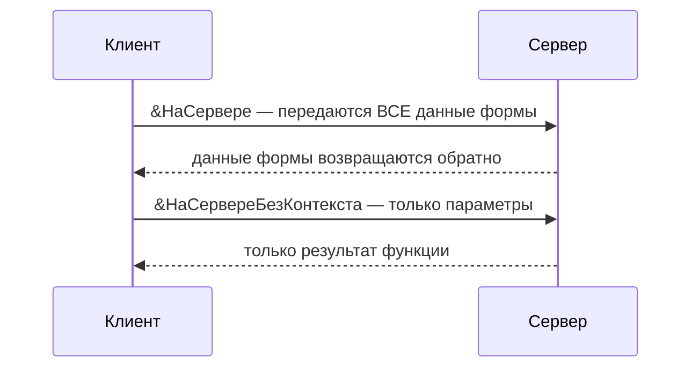

---
tags:
  - 1С/формы
---

> [!abstract] Коротко
> Каждый метод модуля формы помечается директивой: `&НаКлиенте` — интерфейс и действия пользователя, `&НаСервере` — сервер **с данными формы**, `&НаСервереБезКонтекста` — сервер **только с параметрами** (быстрее), `&НаКлиентеНаСервереБезКонтекста` — где вызвали. Работа с базой — только на сервере. Число серверных вызовов минимизируем.

## Модуль формы и модуль объекта

**Модуль формы** (вкладка «Модуль» редактора) — обработчики команд и событий этой формы. **Модуль объекта** документа — правила записи и проведения, которые работают и без формы.

![[УФ-08-Модуль-формы.png]]

*Модуль существующей формы накладной: директивы `&НаКлиенте`, `&НаСервере` перед каждым методом.*

> [!tip] Где что писать
> Быстрый пересчёт при вводе — в форме. Гарантированный пересчёт и проверки при записи — в модуле объекта. Перед правками читаем существующие методы: вторую процедуру с тем же именем создать нельзя.

## Директивы

| Директива | Где выполняется | Доступно |
| --- | --- | --- |
| `&НаКлиенте` | Клиентское приложение | Данные формы, `Элементы`, текущая строка, окна и вопросы |
| `&НаСервере` | Сервер, **с контекстом формы** | Реквизиты формы (`Объект`…), запросы, объекты базы |
| `&НаСервереБезКонтекста` | Сервер, **без контекста** | Только параметры и серверные возможности |
| `&НаКлиентеНаСервереБезКонтекста` | Там, откуда вызвали | Вычисления над параметрами |



> [!warning] На сервере нет интерфейса
> Даже с контекстом формы на сервере нет текущей строки таблицы и нельзя показать окно. Интерактивное — только на клиенте.

## Пример: с контекстом и без

```1C
&НаСервере
Функция ПредставлениеПокупателяСКонтекстом()
	Если НЕ ЗначениеЗаполнено(Объект.Покупатель) Тогда
		Возврат "Покупатель не выбран";
	КонецЕсли;
	Возврат Объект.Покупатель.Наименование;   // обращается к данным формы
КонецФункции

&НаСервереБезКонтекста
Функция ПредставлениеПокупателя(СсылкаНаПокупателя)
	Если НЕ ЗначениеЗаполнено(СсылкаНаПокупателя) Тогда
		Возврат "Покупатель не выбран";
	КонецЕсли;
	Возврат СсылкаНаПокупателя.Наименование;   // только параметр
КонецФункции
```

Вторая функция предпочтительнее: на сервер уходит одна ссылка, а не вся форма. Обращение к `Объект` внутри неё — ошибка.

Вызов из клиентского обработчика команды той же формы:

```1C
ИмяПокупателя = ПредставлениеПокупателя(Объект.Покупатель);
Сообщить(ИмяПокупателя);
```

Клиент берёт ссылку → сервер получает наименование → на клиент возвращается строка. Для вызова метода **своей формы** флаг «Вызов сервера» не нужен — он относится к общим модулям.

## Что передавать между клиентом и сервером

- Передаём простые значения, ссылки, структуры. **Не** передаём `ДокументОбъект` на тонкий клиент.
- Сложение двух чисел — на клиенте; запрос к базе — на сервере.
- Цены для ста строк — **одним** серверным вызовом, а не ста.
- Подготовку данных при открытии делаем в `ПриСозданииНаСервере`, а не вызовом сервера из `ПриОткрытии` — см. [стандарт 1С об оптимизации серверных вызовов](https://kb.1ci.com/1C_Enterprise_Platform/Guides/Developer_Guides/1C_Enterprise_Development_Standards/Client_server_interaction/Server_call_optimization/?language=en).

Серверный вызов — синхронный: код после него продолжится, когда придёт результат. Это не фоновое задание.

## Типичные ошибки

| Ошибка | Причина |
| --- | --- |
| «Переменная не определена (Объект)» | Метод `&НаСервереБезКонтекста` — данные передаём параметрами |
| «Метод не найден» / «недоступен на клиенте» | Серверная операция (запрос, `ПолучитьОбъект`) в клиентской процедуре |
| Функция есть, но ничего не происходит | Её никто не вызывает: нет связи с командой или событием |
| Метод не виден из другого модуля | Метод формы локален; общие методы — в общих модулях |

> [!question]- Проверь себя
> 1. Почему `&НаСервереБезКонтекста` предпочтительнее `&НаСервере`?
> 2. Можно ли в серверном методе формы спросить пользователя «Продолжить?»
> 3. Где выполнить запрос цены выбранного товара?
>
> > [!success]- Ответы
> > 1. Не передаются данные формы — меньше трафика и быстрее.
> > 2. Нет, вопросы — только на клиенте.
> > 3. В серверной функции (лучше без контекста), передав ссылку на товар.

%% навигация %%

---
← [[04. Программирование управляемых форм/04. Группы и страницы|04. Группы и страницы]] · [[04. Программирование управляемых форм/00. Навигация по разделу|↑ Раздел]] · [[00. Оглавление|⌂ Оглавление]] · [[04. Программирование управляемых форм/06. Команды формы и кнопки|06. Команды формы и кнопки]] →
