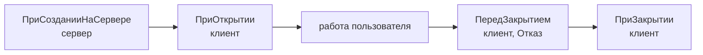

---
tags:
  - 1С/формы
---

> [!abstract] Коротко
> Жизненный цикл формы: `ПриСозданииНаСервере` (сервер — подготовка данных и настроек) → `ПриОткрытии` (клиент) → … → `ПередЗакрытием` (можно отменить) → `ПриЗакрытии`. Начальные значения готовим **на сервере при создании**, чтобы не делать лишний серверный вызов. Обработчик работает, только если он **назначен** в свойствах формы.

## События формы



| Событие | Контекст | Для чего |
| --- | --- | --- |
| `ПриСозданииНаСервере` | Сервер с контекстом | Начальные значения, настройки элементов, данные из базы |
| `ПриОткрытии` | Клиент | Клиентские действия при показе окна |
| `ПередЗакрытием` | Клиент | Проверка, можно ли закрыть |
| `ПриЗакрытии` | Клиент | Завершающие действия; отменить закрытие уже нельзя |

Если платформа активирует **уже открытое** окно, оно не создаётся заново — `ПриСозданииНаСервере` не повторится.

## Где найти события

Вкладка **Форма** → выделяем **корень** дерева «Форма» (не поле!) → свойства → **События**:

![[УФ-07-События-формы.png]]

*События формы накладной: `ПриСозданииНаСервере`, `ПриОткрытии`, `ПередЗаписью` и др.*

Обработчик есть — переходим к нему; нет — создаём кнопкой рядом. Конфигуратор подставит правильные параметры.

> [!warning] Связь обязательна
> Процедура с именем `ПриОткрытии` без указания в свойствах **не вызовется**. Имена обработчиков формы могут быть любыми, параметры — как у события. См. [учебный разбор 1С](https://kb.1ci.com/1C_Enterprise_Platform/Tutorials/Practical_developer_guide_8.3/Lesson_5._Theory/Event_handler_procedures_in_form_modules/).

## Начальный итог при создании

```1C
&НаСервере
Процедура ПриСозданииНаСервере(Отказ, СтандартнаяОбработка)

	ИтогТоваров = Объект.Товары.Итог("Сумма");

КонецПроцедуры
```

Если обработчик уже существует — добавляем только строку расчёта (после заполнения товаров, если оно там есть). Не обходим проверки, которые устанавливают `Отказ`, и не пишем `Отказ = Ложь`.

`Объект.Товары` к этому моменту уже заполнен: для существующей накладной — её строками. Документ при открытии **не записываем**.

## ПриОткрытии — для клиентских действий

```1C
&НаКлиенте
Процедура ПриОткрытии(Отказ)
	Сообщить("Форма открыта. Итог товаров: " + ИтогТоваров);   // временная диагностика
КонецПроцедуры
```

После проверки сообщение удаляем. Данные из базы здесь не получаем — их готовит `ПриСозданииНаСервере`.

## Закрытие

Платформа сама спрашивает о сохранении изменённого документа — не заменяем это своим вопросом без причины. Закрытие окна не означает записи. Для собственного подтверждения используем асинхронный вопрос ([[22. Асинхронные вопросы пользователю]]). При завершении всего приложения в обработчиках закрытия есть ограничения — см. [документацию 1С](https://kb.1ci.com/1C_Enterprise_Platform/Guides/Developer_Guides/1C_Enterprise_8.3.23_Developer_Guide/Chapter_7._Forms/7.9._Working_with_a_form_from_the_1C_Enterprise_language/7.9.7._Different_approaches_to_modality/?language=en).

## Проверка

1. Открываем накладную с суммами 300 и 300 — сразу видим **600**; новую пустую — **0**.
2. Ставим точки останова в обоих обработчиках: сначала остановимся на сервере, затем на клиенте.

Не вызываем обработчики друг из друга «для проверки»: прямой вызов не воспроизводит жизненный цикл формы.

> [!question]- Проверь себя
> 1. Почему данные для формы готовят в `ПриСозданииНаСервере`, а не в `ПриОткрытии`?
> 2. В каком событии можно отменить закрытие?
> 3. Переключились на уже открытую накладную. Сработает ли `ПриСозданииНаСервере`?
>
> > [!success]- Ответы
> > 1. Форма создаётся на сервере — данные уходят на клиент вместе с ней, без лишнего вызова.
> > 2. `ПередЗакрытием` (параметр `Отказ`).
> > 3. Нет, форма не создаётся повторно.

%% навигация %%

---
← [[04. Программирование управляемых форм/06. Команды формы и кнопки|06. Команды формы и кнопки]] · [[04. Программирование управляемых форм/00. Навигация по разделу|↑ Раздел]] · [[00. Оглавление|⌂ Оглавление]] · [[04. Программирование управляемых форм/08. Изменение полей и обработчики событий|08. Изменение полей и обработчики событий]] →
