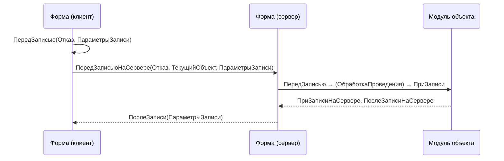

---
tags:
  - 1С/формы
---

> [!abstract] Коротко
> При записи из формы платформа превращает данные формы в объект и проходит цепочку: `ПередЗаписью` (клиент формы) → `ПередЗаписьюНаСервере` → `ПередЗаписью` **модуля объекта** → запись → `ПриЗаписиНаСервере` → `ПослеЗаписиНаСервере` → `ПослеЗаписи` (клиент). Предварительная проверка — в форме, обязательные расчёты и правила — в объекте. В серверных событиях формы записываемый объект — `ТекущийОбъект`.

## Стандартные команды

| Команда | Что делает |
| --- | --- |
| «Записать» | Записывает, форма остаётся открытой |
| «Записать и закрыть» | Записывает и закрывает при успехе |
| «Провести» / «Провести и закрыть» | Запись в режиме проведения — с движениями |

Проведение — отдельная операция; не подменяем её `Объект.Проведен = Истина`.

![[УФ-12-Форма-в-предприятии.png]]

*Форма накладной со стандартными командами записи и проведения.*

## Порядок событий



| Где | Обработчик | Для чего |
| --- | --- | --- |
| Форма, клиент | `ПередЗаписью(Отказ, ПараметрыЗаписи)` | Быстрая проверка, вопрос пользователю |
| Форма, сервер | `ПередЗаписьюНаСервере(Отказ, ТекущийОбъект, ПараметрыЗаписи)` | Перенести в `ТекущийОбъект` данные из реквизитов формы |
| **Модуль объекта** | `ПередЗаписью(Отказ, РежимЗаписи, РежимПроведения)` | **Обязательные** правила и расчёты |
| Форма, сервер | `ПриЗаписиНаСервере`, `ПослеЗаписиНаСервере` | Действия формы во время/после записи |
| Форма, клиент | `ПослеЗаписи(ПараметрыЗаписи)` | Обновить интерфейс, сообщить об успехе |

Точный порядок для своего случая (с подписками, проверкой заполнения, проведением) проверяем отладчиком.

> [!info] `ТекущийОбъект`
> В серверных событиях записи формы это уже прикладной объект, который будет записан. Чтобы перенести значение из реквизита формы в документ — меняем `ТекущийОбъект.Реквизит`, а не `Объект.Реквизит`.

## Клиентская проверка

Свойства корня формы → События → **ПередЗаписью** (клиент):

```1C
&НаКлиенте
Процедура ПередЗаписью(Отказ, ПараметрыЗаписи)

	Если Отказ Тогда
		Возврат;
	КонецЕсли;
	Если НЕ ПроверитьДанныеФормы() Тогда   // из темы 12
		Отказ = Истина;
	КонецЕсли;

КонецПроцедуры
```

`ПараметрыЗаписи` — параметры операции (режимы записи/проведения), а не реквизиты документа.

## Окончательный расчёт в объекте

В модуле объекта `РасходнаяНакладная`:

```1C
Процедура ПересчитатьСуммыТоваров() Экспорт
	Для Каждого СтрокаТовара Из Товары Цикл
		СтрокаТовара.Сумма = Окр(СтрокаТовара.Количество * СтрокаТовара.Цена, 2);
	КонецЦикла;
КонецПроцедуры

Процедура ПередЗаписью(Отказ, РежимЗаписи, РежимПроведения)

	Если Отказ Тогда
		Возврат;
	КонецЕсли;
	Если НЕ ДанныеКорректны() Тогда   // из темы 12
		Отказ = Истина;
		Возврат;
	КонецЕсли;

	ПересчитатьСуммыТоваров();
	// Существующий расчёт услуг и общего итога документа — сохраняем

КонецПроцедуры
```

> [!warning] Важно
> Дорабатываем существующий `ПередЗаписью`, а не добавляем второй. Если суммы уже считались в цикле — переносим цикл в `ПересчитатьСуммыТоваров()`. `Экспорт` понадобится в теме 14.

## После записи

```1C
&НаКлиенте
Процедура ПослеЗаписи(ПараметрыЗаписи)
	ПересчитатьИтогТоваров();   // данные вернулись с сервера уже пересчитанными
КонецПроцедуры
```

Сообщение «Документ записан» уместно здесь, а не до записи. Серверные действия после записи — в `ПослеЗаписиНаСервере`, без отдельного серверного вызова ([стандарт 1С](https://kb.1ci.com/1C_Enterprise_Platform/Guides/Developer_Guides/1C_Enterprise_Development_Standards/Client_server_interaction/Server_call_optimization/?language=en)).

## Своя команда записи

Обычно хватает стандартных. Для изучения:

```1C
&НаКлиенте
Процедура ЗаписатьУчебно(Команда)
	Записать(Новый Структура("РежимЗаписи", РежимЗаписиДокумента.Запись));
КонецПроцедуры
```

`Записать()` — метод **формы**: запускает стандартный механизм со всеми событиями. Не пишем `Объект.Записать()` и не вызываем `ПередЗаписью` вручную.

## Проверка

1. Пустой покупатель — запись запрещает клиентская проверка.
2. Точка останова в `ПередЗаписью` объекта — при корректных данных он выполняется.
3. После записи сумма строки = количество × цена с округлением.
4. Переоткрываем документ — строки сохранились, итог восстановился.
5. Запись из серверной обработки с недопустимым количеством — запрещена объектом (события формы там не участвуют).

> [!question]- Проверь себя
> 1. Где разместить правило, которое должно работать и при загрузке из файла?
> 2. В `ПередЗаписьюНаСервере` нужно записать в документ значение реквизита формы. Куда присваиваем?
> 3. Почему в клиентском коде нельзя `Объект.Записать()`?
>
> > [!success]- Ответы
> > 1. В `ПередЗаписью` модуля объекта.
> > 2. В `ТекущийОбъект.ИмяРеквизита`.
> > 3. `Объект` — данные формы, у них нет метода записи; запись формы — метод `Записать()` самой формы.

%% навигация %%

---
← [[04. Программирование управляемых форм/12. Проверка заполнения и сообщения|12. Проверка заполнения и сообщения]] · [[04. Программирование управляемых форм/00. Навигация по разделу|↑ Раздел]] · [[00. Оглавление|⌂ Оглавление]] · [[04. Программирование управляемых форм/14. Данные формы и прикладной объект|14. Данные формы и прикладной объект]] →
