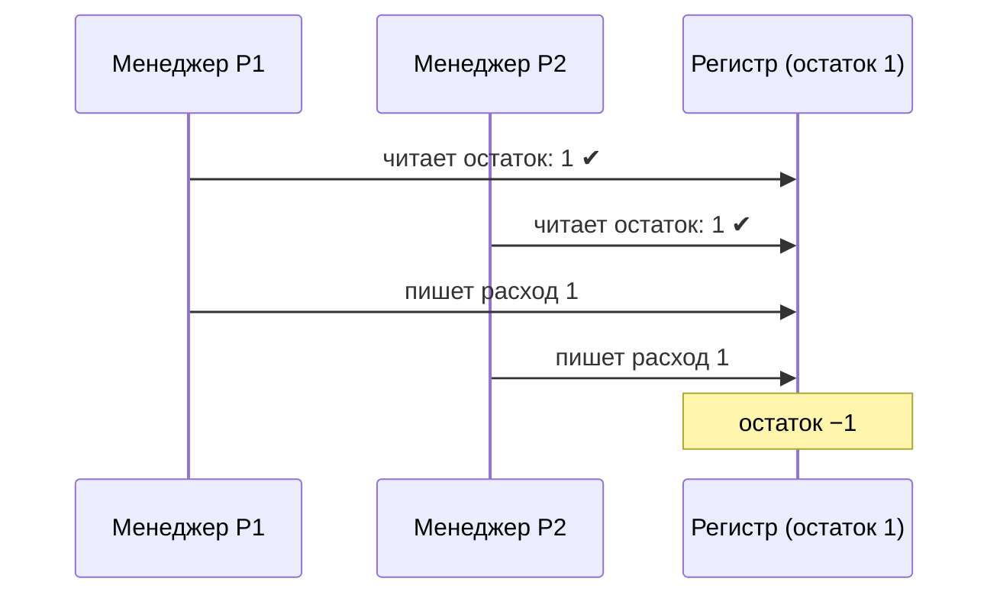

---
tags:
  - 1С/профессия
---

> [!abstract] Коротко
> Контроль «нельзя отгрузить больше, чем есть» пишет разработчик в `ОбработкаПроведения`. Современная схема («новая методика»): **записать расход с блокировкой** (`БлокироватьДляИзменения = Истина`, `Записать()`), затем **запросом найти отрицательные остатки** по товарам документа; нашли — сообщение и `Отказ = Истина`, транзакция откатится. Управляемая блокировка не даёт двум пользователям одновременно продать последнюю штуку.

## Почему «проверить и записать» недостаточно



Обе проверки прошли, потому что выполнялись **до** записи другого. Нужна **блокировка**: пока транзакция А не завершилась, Б ждёт, а затем видит уже уменьшенный остаток.

## Режим блокировок

В свойствах корня конфигурации задаём **Режим управления блокировкой данных = Управляемый**. Если основная конфигурация работает в смешанном режиме «Автоматический и управляемый», у участвующих документов и регистров явно выбираем **Управляемый**. Смешанный режим корня сам по себе не гарантирует, что конкретная транзакция выполняется в управляемом режиме.

![[Картинки/05. Профессиональная разработка/02-Режим-блокировок.png]]

*Свойство режима блокировок в палитре свойств конфигурации. Перед примером проверьте режим также у документов и регистра.*

Управляемая блокировка задаёт логическую **область** — сочетания товаров и складов. Физические блокировки СУБД и файловой базы могут быть шире: не следует обещать одинаковую параллельность для этих вариантов. Подробнее — [документация 1С о режимах блокировок](https://1c-dn.com/1c_enterprise/transaction_lock_management/).

## Новая методика: записать → проверить

Модуль объекта `РасходнаяНакладная`:

```1C
Процедура ОбработкаПроведения(Отказ, Режим)

	// 1. Формируем расход и записываем его сразу, с блокировкой
	Движения.ТоварыНаСкладах.Записывать = Истина;
	Движения.ТоварыНаСкладах.БлокироватьДляИзменения = Истина;
	Для Каждого СтрокаТовара Из Товары Цикл
		Движение = Движения.ТоварыНаСкладах.ДобавитьРасход();
		Движение.Период = Дата;
		Движение.Номенклатура = СтрокаТовара.Товар;
		Движение.Склад = Склад;
		Движение.Количество = СтрокаТовара.Количество;
	КонецЦикла;
	Движения.ТоварыНаСкладах.Записать();

	// 2. Контроль — только при оперативном проведении (текущей датой)
	Если Режим = РежимПроведенияДокумента.Оперативный Тогда
		ПроверитьОстатки(Отказ);
	КонецЕсли;

	// ... движения продаж и прочее — как раньше

КонецПроцедуры

Процедура ПроверитьОстатки(Отказ)

	Запрос = Новый Запрос(
	"ВЫБРАТЬ
	|	О.Номенклатура КАК Номенклатура,
	|	О.Номенклатура.Наименование КАК Наименование,
	|	-О.КоличествоОстаток КАК Нехватка
	|ИЗ
	|	РегистрНакопления.ТоварыНаСкладах.Остатки(
	|		,
	|		(Номенклатура, Склад) В
	|			(ВЫБРАТЬ Т.Номенклатура, Т.Склад
	|			ИЗ РегистрНакопления.ТоварыНаСкладах КАК Т
	|			ГДЕ Т.Регистратор = &Ссылка)) КАК О
	|ГДЕ
	|	О.КоличествоОстаток < 0");
	Запрос.УстановитьПараметр("Ссылка", Ссылка);

	Выборка = Запрос.Выполнить().Выбрать();
	Пока Выборка.Следующий() Цикл
		Сообщение = Новый СообщениеПользователю;
		Сообщение.Текст = СтрШаблон("Не хватает «%1»: %2 шт.", Выборка.Наименование, Выборка.Нехватка);
		Сообщение.УстановитьДанные(ЭтотОбъект);
		Сообщение.Сообщить();
		Отказ = Истина;
	КонецЦикла;

КонецПроцедуры
```

Разбор:

| Строка | Зачем |
| --- | --- |
| `БлокироватьДляИзменения = Истина` | При записи набор **исключительно блокирует** изменяемую область регистра до конца транзакции |
| `Записать()` сразу | Движения уже в базе (внутри транзакции проведения) — запрос остатков их учтёт. После `Записать()` флаг `Записывать` сбрасывается, повторной записи в конце не будет |
| Условие `(Номенклатура, Склад) В (… Регистратор = &Ссылка)` | Проверяем только товары этого документа |
| Пустой первый параметр `Остатки(, …)` | Текущие итоги с учётом уже записанных движений документа; после ожидания блокировки учитываем и завершившуюся чужую транзакцию |
| `ГДЕ КоличествоОстаток < 0` | Отрицательный остаток = нехватка |
| `Отказ = Истина` | Проведение отменяется, транзакция откатывает записанные движения |

> [!info] Почему проверка только в оперативном режиме
> Это **выбранное правило учебного примера**: проверяем текущие итоги только при оперативном проведении. При неоперативном проведении этот код проверки не выполняет и минус возможен. Если по заданию расход без остатка запрещён всегда, отдельно определите правила для прошлых и будущих дат, отмены проведения прихода и перепроведения зависимых документов. Исторический остаток на момент документа и текущий остаток — разные проверки; замена пустого параметра на `МоментВремени()` сама по себе задачу не решает.

## Классическая схема: заблокировать → прочитать → записать

Встречается в старом коде и полезна, когда остатки нужны **до** формирования движений (например, для списания по партиям):

```1C
Блокировка = Новый БлокировкаДанных;
ЭлементБлокировки = Блокировка.Добавить("РегистрНакопления.ТоварыНаСкладах");
ЭлементБлокировки.Режим = РежимБлокировкиДанных.Исключительный;
ЭлементБлокировки.ИсточникДанных = Товары;
ЭлементБлокировки.ИспользоватьИзИсточникаДанных("Номенклатура", "Товар");
ЭлементБлокировки.УстановитьЗначение("Склад", Склад);
Блокировка.Заблокировать();

// теперь читаем остатки запросом — никто не изменит их до конца транзакции
```

| Свойство | Смысл |
| --- | --- |
| `Добавить("РегистрНакопления.…")` | Какое пространство блокируем |
| `Режим` | `Исключительный` — для изменения; `Разделяемый` — для согласованного чтения |
| `ИсточникДанных` + `ИспользоватьИзИсточникаДанных` | Значения поля берём из колонки табличной части — блокируются только эти товары |
| `УстановитьЗначение` | Фиксированное значение поля |
| `Заблокировать()` | Работает только **внутри транзакции** (в проведении она уже есть) |

## Где ещё нужна блокировка

- Нумерация «своими силами», расчёт очередного номера — блокируем, иначе дубли.
- Изменение объекта, прочитанного ранее: `Объект.Заблокировать()` — отдельный механизм блокировки редактирования объекта; он не заменяет блокировку области регистра и имеет свой порядок освобождения.
- Обработка, которая читает и затем меняет одни и те же данные.

> [!warning] Короткие транзакции
> Блокировка держится до конца транзакции. Никаких вопросов пользователю, HTTP-запросов и долгих циклов внутри проведения — иначе другие пользователи будут ждать, а при большой очереди получат ошибку таймаута блокировки. Подробнее — [[02. Программирование/28. Транзакции и блокировки|28. Транзакции и блокировки]].

## Проверка

1. Приход 10 чайников → расход 3 → проведён, остаток 7.
2. Расход 8 → отказ «Не хватает «Чайник»: 1 шт.», движений нет.
3. Две строки одного товара по 4 и 4 при остатке 7 → отказ на нехватку 1 (запрос остатков учитывает обе строки).
4. На платформе, допускающей два сеанса: приход 1; в каждом сеансе подготовить расход 1 одного товара с одного склада. В первом остановиться после `Записать()`, во втором начать проведение, затем продолжить первый. Первый расход проходит, второй после ожидания получает отказ. При достаточном остатке оба расхода должны проходить.

> [!info] Проверка на учебной платформе
> В версии для обучения программированию разрешён один сеанс работы с базой. Пункты 1–3 можно выполнить здесь; конкурентный сценарий — на отдельном стенде с платформой, допускающей несколько сеансов. См. [ограничения учебной версии от 1С](https://v8.1c.ru/upload/iblock/989/9893a2b23aa198b9b491dd90ffe2bffa.pdf).

> [!question]- Проверь себя
> 1. Почему проверка «прочитать остаток → записать» без блокировки ненадёжна?
> 2. Зачем в новой методике писать движения **до** проверки?
> 3. Что откатывает `Отказ = Истина` после `Записать()`?
> 4. Где работает `Блокировка.Заблокировать()`?
>
> > [!success]- Ответы
> > 1. Два сеанса могут прочитать одинаковый остаток до записи друг друга.
> > 2. Запись с блокировкой захватывает область и сразу учитывает движения документа в остатке — проверка становится одним запросом.
> > 3. Всю транзакцию проведения, включая записанные движения.
> > 4. Только внутри транзакции.

%% навигация %%

---
← [[05. Профессиональная разработка/01. Регистр остатков на практике|01. Регистр остатков на практике]] · [[05. Профессиональная разработка/00. Навигация по разделу|↑ Раздел]] · [[00. Оглавление|⌂ Оглавление]] · [[05. Профессиональная разработка/03. Печатная форма документа|03. Печатная форма документа]] →
