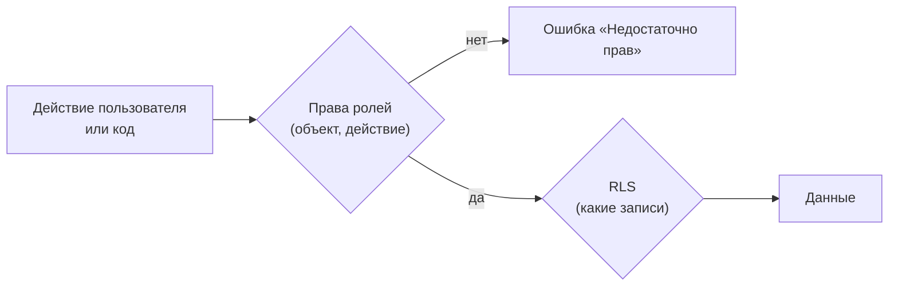

---
tags:
  - 1С/профессия
---

> [!abstract] Коротко
> Код выполняется **с правами текущего пользователя**: платформа сама проверяет права при чтении и записи. В коде права проверяют `ПравоДоступа()` и `РольДоступна()`. **RLS** (ограничение доступа на уровне записей) — условие в роли, которое платформа добавляет к каждому запросу; запросы к таким данным пишут с `ВЫБРАТЬ РАЗРЕШЕННЫЕ`. **Привилегированный режим** отключает проверку прав — только точечно и осознанно.

## Где проверяются права



Платформа проверяет права **всегда** — и в форме, и в обработке, и в фоновом задании (с правами пользователя задания). Поэтому код не нужно «защищать» повторной проверкой каждого чтения: достаточно правильно настроить роли.

## Проверка прав в коде

Нужна, чтобы **заранее** скрыть недоступное или дать понятное сообщение вместо системной ошибки:

```1C
// Есть ли у пользователя право на действие с объектом
Если НЕ ПравоДоступа("Проведение", Метаданные.Документы.РасходнаяНакладная) Тогда
	Элементы.ФормаПровести.Видимость = Ложь;
КонецЕсли;

// Есть ли конкретная роль (для особых сценариев)
Если РольДоступна("Администрирование") Тогда ...
```

| Функция | Что проверяет | Когда |
| --- | --- | --- |
| `ПравоДоступа("Право", ОбъектМетаданных)` | Право по **всем** ролям пользователя | Предпочтительно: не зависит от названий ролей |
| `РольДоступна("ИмяРоли")` | Назначена ли роль | Редко: права обычно проверяют, а не роли |

Права для каждого вида объекта — в Синтакс-помощнике у `ПравоДоступа` (Чтение, Добавление, Изменение, Удаление, Проведение, Просмотр, ИнтерактивноеДобавление…).

> [!warning] Скрыть кнопку ≠ запретить
> Видимость кнопки по `ПравоДоступа` — удобство. Запрет обеспечивает сама роль.

## RLS — ограничение по записям

![[Картинки/05. Профессиональная разработка/05-Права-документа.png]]

*Редактор существующей роли `РаботаСДанными`: выбран документ `РасходнаяНакладная` и право «Чтение». Область «Ограничения доступа к данным» пока пуста — RLS здесь ещё не настроено. Снимок показывает место настройки; для упражнения создайте отдельную роль «Менеджер».*

Задача: менеджер видит **только накладные своей организации**.

Сначала добавьте справочник `Организации` и реквизит `Организация` такого же ссылочного типа в `РасходнаяНакладная`: это **новые объекты примера**, в исходной учебной базе их может не быть. Заполните организацию у тестовых документов.

1. Параметр сеанса `ТекущаяОрганизация` (`СправочникСсылка.Организации`), заполняется в модуле сеанса:

```1C
Процедура УстановкаПараметровСеанса(ТребуемыеПараметры)
	ПараметрыСеанса.ТекущаяОрганизация = ОрганизацияТекущегоПользователя();   // наша функция
КонецПроцедуры
```

`ОрганизацияТекущегоПользователя()` — функция прикладного решения, которую нужно реализовать отдельно: получить организацию из доверенного серверного сопоставления с пользователем, например регистра сведений. Не берите это значение из произвольного параметра клиента. Пока функция не реализована и параметр не заполнен, пример RLS не готов к запуску.

2. В роли «Менеджер» → `РасходнаяНакладная` → право **Чтение** → **Ограничение доступа к данным** (поле справа внизу):

```text
РасходнаяНакладная ГДЕ РасходнаяНакладная.Организация = &ТекущаяОрганизация
```

Аналогично — для «Изменения», «Добавления», «Удаления». Текст — фрагмент языка запросов, параметры — **параметры сеанса**.

3. Платформа добавит это условие к каждому обращению к накладным у пользователей с этой ролью: в списках, отчётах, запросах.

> [!warning] Права ролей складываются
> Проверяйте **все** роли пользователя: другая роль с неограниченным чтением той же таблицы может открыть записи, которые ограничены в роли «Менеджер». Сам факт настройки RLS в одной роли ещё не доказывает, что пользователь ограничен.

> [!info] Два поведения RLS
> Обычный запрос без `РАЗРЕШЕННЫЕ`, затронувший недоступные записи, завершается ошибкой «Недостаточно прав» — пользователь не получит «неполные» данные молча. Динамические списки и отчёты СКД по умолчанию получают только разрешённые записи.

### `ВЫБРАТЬ РАЗРЕШЕННЫЕ`

```1C
ВЫБРАТЬ РАЗРЕШЕННЫЕ
	Н.Ссылка, Н.ИтоговаяСумма
ИЗ Документ.РасходнаяНакладная КАК Н
```

Запрос вернёт только доступные записи. Без `РАЗРЕШЕННЫЕ` пользователь с RLS получит ошибку «Недостаточно прав», если в выборку попадёт недоступная запись. `РАЗРЕШЕННЫЕ` **не выдаёт** прав — только отбрасывает чужое. Для общих итогов по всей базе (например, контроль остатков) это может дать неверный результат — тогда нужен привилегированный режим.

## Привилегированный режим

Иногда операция должна выполниться **независимо** от прав пользователя: проверка остатков по всем складам, запись служебного журнала.

```1C
УстановитьПривилегированныйРежим(Истина);
Попытка
	// Небольшая доверенная серверная операция без проверки прав и RLS.
Исключение
	УстановитьПривилегированныйРежим(Ложь);
	ВызватьИсключение;
КонецПопытки;
УстановитьПривилегированныйРежим(Ложь);
```

В пределах одного метода каждому нашему включению соответствует наше выключение — и при успехе, и при исключении. Платформа учитывает вложенные включения; это не простое присваивание булевого флага. Не выходите через `Возврат` из середины фрагмента до парного выключения. Правило описано в [руководстве разработчика 1С, раздел 5.5.4.2](https://1c-dn.com/library/tutorials/1c_enterprise_developer_guide_8_3_27/).

Или общий модуль с флагом **«Привилегированный»** — все его методы выполняются без проверки прав.

| Правило | Почему |
| --- | --- |
| Только на сервере, только в нужном фрагменте | Минимум кода без контроля |
| Не выполнять в нём то, что передано с клиента «как есть» (имена таблиц, тексты запросов) | Иначе пользователь получит доступ ко всему |
| Не включать, чтобы «убрать ошибку прав» | Ошибка прав — повод настроить роль |

## Права в типовых конфигурациях

В решениях на БСП роли не назначают напрямую: администратор работает с **профилями групп доступа** и **группами доступа**, а RLS построено на шаблонах подсистемы «Управление доступом» (`#ПоЗначениям(...)`). Для своих объектов в типовой конфигурацию встраиваются по документации БСП ([[09. БСП и типовые конфигурации]]).

## Проверка

1. Пользователь с ролью «Менеджер» и организацией А видит только накладные А в списке и отчёте.
2. Запрос без `РАЗРЕШЕННЫЕ` под этим пользователем при наличии накладных Б — ошибка; с `РАЗРЕШЕННЫЕ` — только А.
3. Кнопка «Провести» скрыта у пользователя без права «Проведение» и при этом документ не проводится и из обработки.

> [!question]- Проверь себя
> 1. Нужно ли перед каждым запросом проверять `ПравоДоступа("Чтение", …)`?
> 2. Что делает `РАЗРЕШЕННЫЕ`, а чего не делает?
> 3. Когда допустим привилегированный режим?
> 4. Откуда RLS берёт значение `&ТекущаяОрганизация`?
>
> > [!success]- Ответы
> > 1. Нет, платформа проверяет права сама; проверка в коде — для интерфейса и понятных сообщений.
> > 2. Отбрасывает недоступные записи; новых прав не даёт.
> > 3. В небольшом серверном фрагменте, где операция по смыслу должна видеть все данные, и без входных данных «как есть» от клиента.
> > 4. Из параметра сеанса, заполненного в `УстановкаПараметровСеанса`.

%% навигация %%

---
← [[05. Профессиональная разработка/04. Расширения и перехват методов|04. Расширения и перехват методов]] · [[05. Профессиональная разработка/00. Навигация по разделу|↑ Раздел]] · [[00. Оглавление|⌂ Оглавление]] · [[05. Профессиональная разработка/06. HTTP-запросы к внешним сервисам|06. HTTP-запросы к внешним сервисам]] →
