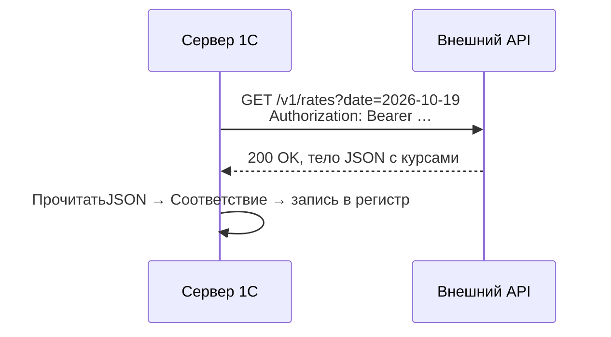

---
tags:
  - 1С/профессия
---

> [!abstract] Коротко
> Обращение к внешнему REST API: `HTTPСоединение` (сервер, порт, таймаут, SSL) + `HTTPЗапрос` (адрес ресурса, заголовки, тело) → `Получить()` / `ОтправитьДляОбработки()` / `ВызватьHTTPМетод()` → `HTTPОтвет` (`КодСостояния`, тело). Тело JSON разбираем `ПрочитатьJSON`. Выполняем **на сервере**, с таймаутом и обработкой ошибок, без секретов в коде и **вне транзакции**.

## Схема обмена



## GET-запрос и разбор JSON

Общий модуль `ИнтеграцияСервер` (флаг «Сервер»):

![[Картинки/05. Профессиональная разработка/06-Свойства-серверного-модуля.png]]

*Палитра существующего серверного модуля `ПроверкиОбъектов`: «Сервер» включён, «Клиент» и «Вызов сервера» выключены. Это образец расположения свойств, а не готовый модуль интеграции. Для `ИнтеграцияСервер` создайте отдельный модуль с флагом «Сервер»; флаг «Внешнее соединение» из показанного модуля копировать для HTTP-запроса не нужно.*

Адрес `api.example.ru` и `/v1/rates` — **условный контракт**, не готовый сервис курсов. Перед запуском подставьте адрес реального API и реализуйте `ТокенAPI()` по правилам своего решения; в учебном стенде удобно использовать локальный сервис с заранее известным JSON.

```1C
// Возвращает курсы валют на дату или Неопределено при ошибке.
Функция КурсыВалют(НаДату) Экспорт

	Соединение = Новый HTTPСоединение(
		"api.example.ru",                    // сервер, без https://
		443,                                  // порт
		, ,                                   // пользователь, пароль (не используем)
		,                                     // прокси
		30,                                   // таймаут, сек
		Новый ЗащищенноеСоединениеOpenSSL);   // HTTPS

	Запрос = Новый HTTPЗапрос("/v1/rates?date=" + Формат(НаДату, "ДФ=yyyy-MM-dd"));
	Запрос.Заголовки.Вставить("Accept", "application/json");
	Запрос.Заголовки.Вставить("Authorization", "Bearer " + ТокенAPI());   // ТокенAPI() — наша функция чтения токена из защищённого места

	Попытка
		Ответ = Соединение.Получить(Запрос);
	Исключение
		ЗаписьЖурналаРегистрации("Интеграция.КурсыВалют", УровеньЖурналаРегистрации.Ошибка, , ,
			ПодробноеПредставлениеОшибки(ИнформацияОбОшибке()));
		Возврат Неопределено;                // нет связи, таймаут, ошибка SSL
	КонецПопытки;

	Если Ответ.КодСостояния <> 200 Тогда
		ЗаписьЖурналаРегистрации("Интеграция.КурсыВалют", УровеньЖурналаРегистрации.Ошибка, , ,
			СтрШаблон("Код %1: %2", Ответ.КодСостояния, Ответ.ПолучитьТелоКакСтроку()));
		Возврат Неопределено;
	КонецЕсли;

	Чтение = Новый ЧтениеJSON;
	Попытка
		Чтение.УстановитьСтроку(Ответ.ПолучитьТелоКакСтроку());
		Данные = ПрочитатьJSON(Чтение, Истина); // объекты JSON — в Соответствие
	Исключение
		Чтение.Закрыть();
		ЗаписьЖурналаРегистрации("Интеграция.КурсыВалют", УровеньЖурналаРегистрации.Ошибка, , ,
			"Сервис вернул ответ 200 с некорректным JSON");
		Возврат Неопределено;
	КонецПопытки;
	Чтение.Закрыть();

	Возврат Данные;

КонецФункции
```

| Элемент | Зачем |
| --- | --- |
| `ЗащищенноеСоединениеOpenSSL` | Включает TLS для HTTPS. Порт задаётся отдельно: число `443` без защищённого соединения само по себе не включает HTTPS |
| Таймаут | Без него зависший сервер «повесит» сеанс |
| `Попытка` вокруг вызова | Исключение возникает при **сетевой** ошибке; HTTP-коды 4xx/5xx исключения не вызывают — их проверяем по `КодСостояния` |
| `ПрочитатьJSON(…, Истина)` | Чтение в `Соответствие`: ключи вроде `"rate-date"` нельзя прочитать в `Структуру` |

После чтения проверьте структуру ответа: корнем JSON может быть не объект, а массив, строка или `null`. Код `200` не гарантирует ни корректный JSON, ни ожидаемые поля. Для POST и остальных методов также нужны обработка сетевой ошибки и проверка `КодСостояния`, как в GET-примере.

## POST с JSON-телом

```1C
ДанныеЗаказа = Новый Структура("number,date,sum", Номер, Формат(Дата, "ДФ=yyyy-MM-ddTHH:mm:ss"), ИтоговаяСумма);

Запись = Новый ЗаписьJSON;
Запись.УстановитьСтроку();
ЗаписатьJSON(Запись, ДанныеЗаказа);
ТелоЗапроса = Запись.Закрыть();

Запрос = Новый HTTPЗапрос("/v1/orders");
Запрос.Заголовки.Вставить("Content-Type", "application/json; charset=utf-8");
Запрос.УстановитьТелоИзСтроки(ТелоЗапроса, КодировкаТекста.UTF8, ИспользованиеByteOrderMark.НеИспользовать);

Ответ = Соединение.ОтправитьДляОбработки(Запрос);   // POST
// Соединение.ВызватьHTTPМетод("PATCH", Запрос) — для прочих методов
```

> [!warning] Даты и числа в JSON
> Договариваемся о формате: дата — строка ISO 8601 (`2026-10-19T15:00:00`), число — с точкой. Ссылки 1С внешней системе не понятны — передаём коды, GUID (`Ссылка.УникальныйИдентификатор()`) или внешние идентификаторы.

## Правила надёжной интеграции

| Правило | Почему |
| --- | --- |
| HTTP-вызов **вне транзакции** (не в `ПередЗаписью`/`ОбработкаПроведения`) | Транзакция держит блокировки, пока ждём ответ; откат транзакции не отменит уже отправленный запрос |
| Регламентное или фоновое задание для регулярного обмена | Пользователь не ждёт сеть ([[02. Программирование/32. Фоновые и регламентные задания|32. Фоновые задания]]) |
| Токены и пароли — не в коде | Константа с ограниченными правами или безопасное хранилище БСП (`ОбщегоНазначения.ПрочитатьДанныеИзБезопасногоХранилища`) |
| Идемпотентность | Повторная отправка не должна создавать дубль: передаём наш идентификатор, проверяем «уже отправлено» |
| Журнал регистрации | Код ответа и кратко тело ошибки — для разбора без отладчика |
| Проверка входных данных | Корректный JSON может содержать неожиданные значения ([[02. Программирование/31. Файлы, JSON и временное хранилище|31. JSON]]) |

> [!tip] Отладка запросов
> Для экспериментов удобен Postman или `curl`: сначала добиваемся правильного ответа там, затем переносим адрес, заголовки и тело в код.

> [!question]- Проверь себя
> 1. Вызовет ли ответ 500 исключение в `Соединение.Получить()`?
> 2. Почему HTTP-запрос нельзя делать в `ОбработкаПроведения`?
> 3. Зачем `ПрочитатьJSON(Чтение, Истина)`?
> 4. Где хранить токен API?
>
> > [!success]- Ответы
> > 1. Нет, исключение — только при сетевой ошибке; код 500 проверяем в `КодСостояния`.
> > 2. Долгое ожидание внутри транзакции держит блокировки, а откат проведения не отменит отправленный запрос.
> > 3. Чтобы читать объекты JSON в `Соответствие` — ключи могут не быть корректными именами для `Структуры`.
> > 4. Не в коде: константа с ограниченными правами или безопасное хранилище.

%% навигация %%

---
← [[05. Профессиональная разработка/05. Права доступа и RLS в коде|05. Права доступа и RLS в коде]] · [[05. Профессиональная разработка/00. Навигация по разделу|↑ Раздел]] · [[00. Оглавление|⌂ Оглавление]] · [[05. Профессиональная разработка/07. HTTP-сервисы своей базы|07. HTTP-сервисы своей базы]] →
