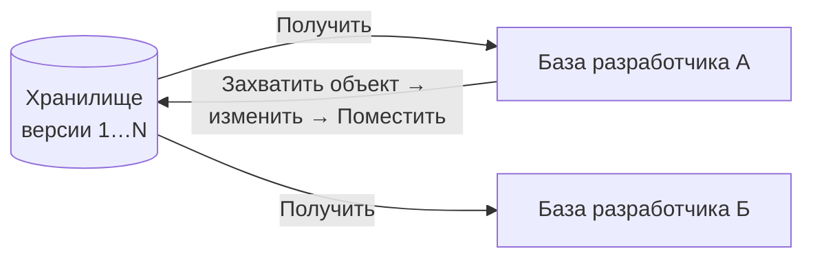

---
tags:
  - 1С/профессия
---

> [!abstract] Коротко
> Командная разработка в 1С идёт двумя путями. **Хранилище конфигурации** — встроенный в Конфигуратор механизм: объекты **захватывают**, меняют и **помещают** обратно с комментарием, история версий хранится в хранилище. **EDT + Git** — проект в виде файлов, ветки, merge request и код-ревью, автоматические проверки. В любой команде нужно уметь: получить актуальную версию, внести изменение в своей базе, отдать его с понятным описанием.

## Хранилище конфигурации

> [!info] Ограничение учебной версии
> Учебная платформа не поддерживает работу с хранилищем конфигурации. Ниже — рабочий процесс для платформы без этого ограничения. Здесь можно изучить команды и выгрузить конфигурацию в файлы; подключение к хранилищу и захват объектов выполняются на отдельном стенде.



Меню **Конфигурация → Хранилище конфигурации**:

| Команда | Что делает |
| --- | --- |
| Создать хранилище | Один раз, ведущий разработчик: каталог или сервер хранилища |
| Подключиться к хранилищу | Связать свою базу с хранилищем (пользователь хранилища ≠ пользователь базы) |
| Окно хранилища | Список объектов и кто что захватил |
| Захватить в хранилище | Взять объект на изменение — другие его менять не смогут |
| Поместить в хранилище | Отдать изменения с **комментарием** |
| Получить из хранилища | Забрать изменения коллег |
| История хранилища | Версии, авторы, сравнение версий |

Рабочий цикл: **получить** → **захватить** нужные объекты → изменить и проверить в своей базе → **поместить** с комментарием «Задача №123: проверка лимита кредита» → коллеги **получают**.

> [!warning] Типичные ошибки
> - Захватить «на всякий случай» всю конфигурацию — коллеги не смогут работать.
> - Поместить, не обновив БД и не проверив — сломать сборку всем.
> - Пустой комментарий — история становится бесполезной.
> - Захваченные объекты — «отпустить» (**Отменить захват**), если работа отменена.

## EDT и Git

**1C:Enterprise Development Tools (EDT)** — среда разработки на базе Eclipse. Конфигурация в ней — **проект из файлов** (каждый объект — XML, каждый модуль — `.bsl`), поэтому подходит обычный Git.

| | Конфигуратор + хранилище | EDT + Git |
| --- | --- | --- |
| Формат | Объекты внутри хранилища | Текстовые файлы |
| Параллельная работа над объектом | Блокировка захватом | Ветки и слияние |
| Код-ревью | Нет встроенного | Merge/Pull request |
| Автопроверки | Вручную | CI: проверка кода, тесты, сборка `.cf` |
| Порог входа | Ниже | Выше, но стандарт в крупных командах |

Минимальный Git-цикл:

```bash
git checkout -b feature/123-credit-limit
```

```bash
git add src/
```

```bash
git commit -m "Задача 123: проверка лимита кредита в расходной накладной"
```

```bash
git push -u origin feature/123-credit-limit
```

Затем — merge request, ревью коллеги, слияние в основную ветку.

Переход без EDT: Конфигуратор умеет **Конфигурация → Выгрузить конфигурацию в файлы** (XML) — эти файлы тоже можно хранить в Git, а утилиты вроде ГитКонвертера синхронизируют хранилище с репозиторием.

![[Картинки/05. Профессиональная разработка/10-Выгрузка-конфигурации-в-файлы.png]]

*Меню учебного Конфигуратора: доступна «Выгрузить конфигурацию в файлы…». Не путайте её с «Сохранить конфигурацию в файл…»: первая создаёт дерево исходников для Git, вторая — один бинарный `.cf`. Пункта работы с хранилищем в этой учебной версии нет.*

Формат выгрузки Конфигуратора и формат проекта EDT различаются. Не смешивайте их в одном каталоге `src/`: выберите принятый в команде формат и инструмент загрузки/сборки.

## Инструменты качества

| Инструмент | Что делает |
| --- | --- |
| **BSL Language Server** / плагин для VS Code | Подсветка ошибок и нарушений стандартов прямо в редакторе |
| **SonarQube + BSL** | Анализ кода в CI: дубли, сложность, ошибки |
| **АПК** (Автоматизированная проверка конфигураций) | Проверка на соответствие стандартам 1С |
| **YAxUnit** | Модульные тесты на встроенном языке |
| **Vanessa Automation** | Сценарные тесты интерфейса (Gherkin: «Дано / Когда / Тогда») |

Не обязательно знать всё на старте — важно понимать, что код проходит автоматические проверки и ревью, и писать его так, чтобы их проходить ([[11. Стандарты кода и самопроверка]]).

## Своя база для разработки

- Работаем **в копии** рабочей базы (или в пустой базе с конфигурацией из хранилища/репозитория), а не в рабочей.
- Тестовые данные — обезличенные.
- Перед большими изменениями — `.dt` своей базы.

> [!question]- Проверь себя
> 1. Коллега захватил документ, вам тоже нужно его изменить. Что делать в хранилище?
> 2. Почему в Git удобнее параллельная работа над одним объектом?
> 3. Что обязательно сделать перед «Поместить в хранилище»?
>
> > [!success]- Ответы
> > 1. Договориться: дождаться помещения или попросить отменить захват; изменить захваченный другим объект нельзя.
> > 2. Изменения в ветках сливаются, блокировок объектов нет; конфликты решаются при слиянии.
> > 3. Обновить БД, проверить изменения и написать понятный комментарий.

%% навигация %%

---
← [[05. Профессиональная разработка/09. БСП и типовые конфигурации|09. БСП и типовые конфигурации]] · [[05. Профессиональная разработка/00. Навигация по разделу|↑ Раздел]] · [[00. Оглавление|⌂ Оглавление]] · [[05. Профессиональная разработка/11. Стандарты кода и самопроверка|11. Стандарты кода и самопроверка]] →
