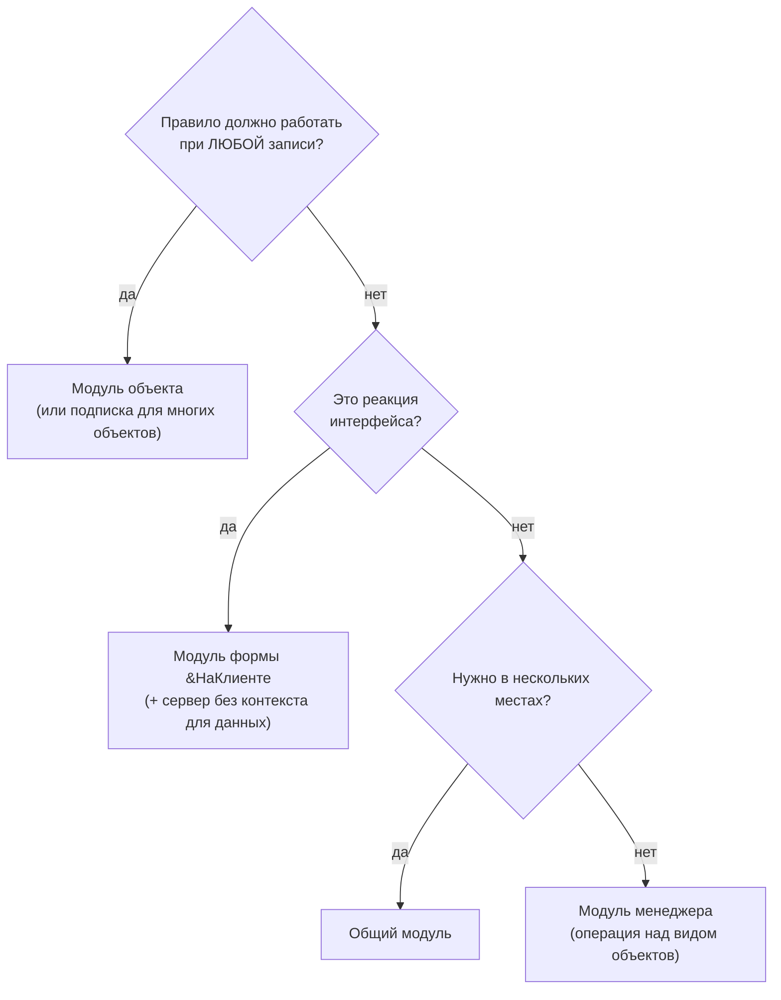

---
tags:
  - 1С/шпаргалка
  - 1С/повторение
---

> [!abstract] О шпаргалке
> Самый частый вопрос новичка — «в какой модуль это писать?». Таблица модулей, ключевых событий и решений «клиент или сервер».

## Модули

| Модуль | Где найти | Что там пишут | Контекст |
| --- | --- | --- | --- |
| Модуль управляемого приложения | ПКМ по корню конфигурации | `ПриНачалеРаботыСистемы`, `ПередЗавершениемРаботыСистемы` | Клиент |
| Модуль сеанса | ПКМ по корню конфигурации | `УстановкаПараметровСеанса` | Сервер |
| Модуль объекта | Объект → «Прочее» | `ПередЗаписью`, `ПриЗаписи`, `ОбработкаПроведения`, `ОбработкаЗаполнения`, `ОбработкаПроверкиЗаполнения`, экспортные методы объекта | Сервер |
| Модуль менеджера | Объект → «Прочее» | Печать, `ОбработкаПолученияПредставления`, `ОбработкаПолученияДанныхВыбора`, операции над видом объекта | Сервер |
| Модуль формы | Редактор формы → «Модуль» | События формы и элементов, команды формы | Клиент + сервер (директивы) |
| Модуль команды | Команда объекта или общая команда | `ОбработкаКоманды(Параметр, ПараметрыВыполнения)` | Клиент (+ серверные функции) |
| Общий модуль | Общие → Общие модули | Повторно используемые методы | По флажкам: Клиент / Сервер / Вызов сервера / Привилегированный |
| Модуль набора записей регистра | Регистр → «Прочее» | `ПередЗаписью`, `ПриЗаписи` набора | Сервер |
| Модуль HTTP-сервиса | Общие → HTTP-сервисы | Обработчики методов шаблонов URL | Сервер |

## Решение «куда писать»

## Клиент или сервер

| Нужно | Где |
| --- | --- |
| Показать вопрос, предупреждение, открыть форму | Клиент |
| Текущая строка таблицы, видимость элемента | Клиент |
| Простая арифметика над данными формы | Клиент |
| Запрос, `ПолучитьОбъект()`, запись, движения | Сервер |
| Чтение реквизита по ссылке (`Ссылка.Наименование`) | Сервер |
| Файлы на диске сервера, HTTP-запросы к внешним сервисам | Сервер |
| Тяжёлая длительная операция | Фоновое задание |

## Директивы модуля формы

| Директива | Данные формы на сервере | Когда |
| --- | --- | --- |
| `&НаКлиенте` | — | Интерфейс и ввод |
| `&НаСервере` | Передаются | Нужно менять реквизиты формы на сервере (`ЗначениеВРеквизитФормы`, `РеквизитФормыВЗначение`) |
| `&НаСервереБезКонтекста` | Не передаются | Получить данные по параметрам — **по умолчанию для серверных функций формы** |
| `&НаКлиентеНаСервереБезКонтекста` | — | Чистые вычисления, нужные и там и там |

## Флажки общего модуля

| Комбинация | Назначение | Пример имени |
| --- | --- | --- |
| Сервер | Серверная логика, вызывается из серверного кода | `ПродажиСервер` |
| Сервер + Вызов сервера | Вызов с клиента | `ПродажиВызовСервера` |
| Клиент | Клиентская логика | `ПродажиКлиент` |
| Клиент + Сервер | Общие вычисления без обращения к базе | `ПродажиКлиентСервер` |
| Сервер + Привилегированный | Без проверки прав — осторожно | `ПродажиПолныеПрава` |

Суффиксы имён — соглашение стандартов 1С: по имени сразу видно, где работает модуль. Подробно — [[02. Программирование/26. Общие модули и контекст выполнения|26. Общие модули и контекст выполнения]].

%% навигация %%

---
← [[99. Шпаргалки/03. Встроенный язык — шпаргалка|03. Встроенный язык — шпаргалка]] · [[00. Оглавление|⌂ Оглавление]]
